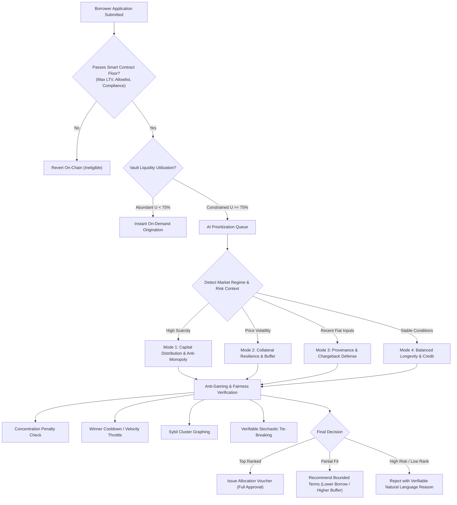

## Abstract

This document defines the functional protocol component specification for the **AI-Managed Lending Platform (AMLP)** on the **XRP Ledger (XRPL) EVM Sidechain**.

AMLP is a delivering decentralized direct
overcollateralized lending and borrowing.
The system combines immutable smart contract risk enforcement with an autonomous,
bounded **AI management**.
The smart contract suite sovereignly governs all financial accounting,
collateral custody, loan-to-value (LTV) limits,
health factor thresholds, and liquidation settlements.
The off-chain AI agent manager provides predictive monitoring,
prioritization of scarce pool liquidity, optimal liquidation coordination,
and post-liquidation recovery reconciliation without possessing custodial access or
the ability to override deterministic contract invariants.

---

## Motivation

In the real world, **private credit and direct lending** ($1.5T+ asset class) operates on a completely different model:

- Capital allocators deploy dedicated credit facilities with specific risk tolerances.
- A dedicated lending manager actively assesses borrower quality, evaluates collateral provenance, manages loan volume during capital scarcity, and orchestrates orderly recoveries.

Decentralized lending protocols have traditionally relied on purely reactive,
uncoordinated liquidation keepers and
static risk parameters.
While functional under benign market conditions,
this paradigm reveals severe structural vulnerabilities during rapid market drawdowns.

### The Case for Bounded Autonomous Risk Coordination

Deploying on the **XRPL EVM Sidechain** enables micro-transaction costs and fast finality. However, achieving capital efficiency requires replacing reactive searcher free-for-alls with **coordinated, intelligent risk management**.

- **Smart contracts must be completely sovereign**: No off-chain entity, including an artificial intelligence agent or administrator, shall have the capability to extract funds, liquidate solvent loans, alter collateral requirements beyond predefined bounds, or bypass programmatic solvency formulas.
- **The AI agent must be strictly bounded**: The agent operates as an intelligent coordinator that monitors telemetry, prioritizes loan applications when liquidity is constrained, orchestrates liquidations to minimize market impact, and verifies post-settlement accounting.

**The Problem Bounded Autonomy**:
A problem in autonomous financial agents is finding the balance between safety and
operational efficiency:

1. **The Friction Trap (Asking Permission for Everything)**: Requiring the human owner to manually sign and approve every loan allocation. Fast-moving market drawdowns on-chain require sub-second liquidation execution, waiting for human confirmation leads to protocol bad debt.
2. **The Catastrophic Risk Trap**: Giving an AI model unrestricted private key access or custodial authority creates intolerable systemic risk from prompt injections, hallucinations, or key compromise.

**The Solution: Bounded Autonomy with Inviolable On-Chain Guardrails**:

1. **Zero Permission for Routine Actions**: The AI Lending Agent operates autonomously 24/7. It assesses incoming borrower requests, issues EIP-712 loan allocation vouchers, prioritizes scarce vault cash, and coordinates liquidations **without asking the owner for permission for each individual action**.
2. **Deterministic On-Chain Invariants**: The agent's intelligence is strictly bounded by sovereign smart contracts. The agent has zero withdrawal authority, cannot liquidate solvent loans (Health Factor $\ge 1.00$), cannot exceed the hardcoded 70% LTV floor, and cannot divert funds from hardcoded vault destinations.
3. **Humans in the Loop for Strategic Governance**: The human owner/multisig retains ultimate sovereignty, receiving structured AI recommendations for high-level strategic decisions:

   - Approving new collateral tokens into the vault.
   - Adjusting dynamic LTV and risk boundaries based on long-term vault performance.
   - Scaling global borrow caps.
   - Reviewing post-incident recovery audits before unpausing the protocol.

### The Power of the XRPL Ecosystem for Direct Credit

Decentralized direct lending facility (private credit) where a capital allocator deploys an autonomous AI agent to manage dedicated funds.
This gives borrowers multiple flexible options to deposit collateral across the XRP ecosystem:

- Native XRP Ledger Escrow Locks (Mainchain):
Borrowers can lock native XRP or issued trustline tokens (IOUs, tokenized assets) directly on the XRP Ledger mainchain using EscrowCreate with SHA-256 crypto-conditions.
Key Benefit - The borrower’s collateral never leaves the sovereign XRP Ledger and is never held by a centralized or custodial bridge wallet.
- Direct XRPL EVM Sidechain Vault Deposits (Sidechain):
Borrowers can deposit approved ERC-20 tokens, wrapped assets, or tokenized Real-World Assets (RWAs) directly into segregated EVM smart contract vaults (CollateralVault.sol).
Key Benefit: Provides instant on-chain origination with zero cross-chain latency.
- Unified Cross-Chain Solvency:
Regardless of whether collateral is locked on the native ledger or the EVM sidechain, the protocol provides unified valuation and borrowing power through Axelar General Message Passing (GMP) and XLS-47d native price oracles.


## Specification

The key words "MUST", "MUST NOT", "REQUIRED", "SHALL", "SHALL NOT", "SHOULD", "SHOULD NOT", "RECOMMENDED", "MAY", and "OPTIONAL" in this document are to be interpreted as described in [RFC 2119](http://tools.ietf.org/html/rfc2119).

---

### Protocol Actors

The platform defines distinct operational actors, each possessing strictly segregated permissions:

| Actor | Functional Role & Permitted Boundaries |
| :--- | :--- |
| **Lender (Liquidity Supplier)** | Deposits supported base stablecoins (RLUSD) into the lending vault to provide liquidity; receives interest-bearing pool receipt shares and redeems them subject to pool availability. |
| **Borrower** | Pledges approved collateral by allowed deposit method. Draws stablecoin debt against their collateral subject to strict LTV limits. |
| **AI Lending Agent** | Authorized off-chain autonomous risk coordinator Holds zero custodial or withdrawal authority. |
| **Fiat Payment Gateway Signer** | Regulated financial institution (integrated with Mastercard API & BVNK rails); verifies fiat clearing and issues cryptographically signed settlement vouchers without touching smart contract gas wallets. |
| **Cross-Chain Witness / Relayer Network** | Decentralized validator committee (leveraging Axelar General Message Passing and XRPL ledger monitors); attests to native XRP Ledger escrow locks and relays fulfillment triggers. |
| **Protocol Operator (Multisig Governance)** | Multi-signature administrator holding timelocked authority to configure asset risk parameters, register oracle adapters, and execute emergency circuit breaker resumption. |

---

### Lender Operations & Liquidity Management

Lenders provide the foundational stablecoin, e.g., RLUSD,
liquidity required for the platform's credit facilities.
This must be sent to the LendingVault contract,
which is a ERC4626 contract issuing shares for the deposit.
Upon deposit, the smart contract mints interest-bearing liquidity shares to the lender's account.
The conversion exchange rate between pool shares and
the underlying stablecoin appreciates continuously as borrowers repay accrued interest:
  $$\text{Shares Minted} = \frac{\text{Amount Deposited} \times \text{Total Shares Outstanding}}{\text{Total Pool Liquid Cash} + \text{Total Borrowed Debt} - \text{Protocol Reserves}}$$

**Pool Utilization & Owner-Configured Interest Rate Mechanics**

This vault is owner-configured interest rate mechanics.
Vault utilization tracks the proportion of the vault owner's supplied stablecoins currently deployed into active loans and
we separate it into 3 distinct categories:

$$\text{Vault Utilization} = \frac{\text{Total Borrowed Debt}}{\text{Total Supplied Cash}}$$

#### Category 1: Predefined Rate Strategies (Owner Choices)

1. Fixed APR Strategy (Private Debt / Predictable Yield)
The owner SHOULD define a single,
static interest rate for all borrowers borrowing from this vault.

> FixedAPR (e.g., flat 8.0% APR).

2. Configurable Utilization Curve (Algorithmic Reserve Protection)
The owner defines dynamic curve parameters to automatically balance borrow demand against vault cash reserves.

Required Attributes:
- Base Rate: Minimum borrow rate when utilization is zero (e.g., 4% APR).
- Target Utilization: The optimal lending sweet spot (e.g., 80%).
- Slope 1 Rate: The rate charged when reaching the target utilization (e.g., 8% APR).
- Scarcity Jump Rate: The steep slope that triggers if utilization exceeds the target (e.g., scaling up to 40%+ to protect the remaining cash reserves and force repayments).
​
The example formula:
$$\text{Borrow APR}(U) = \begin{cases} 
R_0 + \left( \frac{U}{U_{\text{optimal}}} \times R_1 \right) & \text{if } U \le U_{\text{optimal}} \\
R_0 + R_1 + \left( \frac{U - U_{\text{optimal}}}{1 - U_{\text{optimal}}} \times R_2 \right) & \text{if } U > U_{\text{optimal}}
\end{cases}$$


#### Category 2: AI Agent Proposals

The AI Lending Agent monitors vault activity and market conditions, proactively proposing parameter adjustments for the owner to review and approve on their dashboard:

1. **Idle Capital Stimulation**:
   * **Observation**: The vault has sustained excess idle cash and low borrow demand.
   * **Agent Proposal**: Proposes lowering the vault's **Fixed APR** or **Base Rate** to make borrowing more competitive and stimulate new loan origination.

2. **Scarcity & Yield Optimization**:
   * **Observation**: Vault utilization is consistently high and unborrowed cash reserves are running low.
   * **Agent Proposal**: Proposes increasing the **Base Rate**, steepening the **Scarcity Jump Rate**, or adjusting the **Target Utilization** to capture higher yield and protect liquidity for redemptions.

3. **Market Alignment**:
   * **Observation**: Prevailing market rates (e.g., benchmark yields or competitor lending protocols) have shifted away from the vault's rate.
   * **Agent Proposal**: Proposes realigning the vault's **Fixed APR** or **Base Rate** to keep rates competitive and prevent yield arbitrage.

### Borrower Operations, Solvency & Dynamic Allocation

Borrowers lock collateral to unlock borrowing power.
- **Collateral Custody Architecture**:
  Collateral is never commingled with lent funds and is never rehypothecated (re-lent). Assets remain strictly locked as debt security via two paths:
  1. **EVM Collateral**: Approved ERC-20 tokens (wrapped XRP, wrapped Bitcoin, wrapped Ethereum) are locked directly in the Collateral Vault contract on the XRPL EVM Sidechain, tracked in an isolated per-borrower accounting ledger.
  2. **Native XRPL Escrows**: Native XRP remains on the native XRP Ledger in cryptographic escrow objects (`EscrowCreate`). The lock is verified on the EVM sidechain via **Axelar GMP**, and the **AI Lending Agent** coordinates releasing the escrow condition back to the borrower once repayment is verified on-chain.

#### Position Solvency & Loan Health

A borrower's position solvency is continuously evaluated on-chain by the Risk Engine.
A loan's safety is measured by its **Health Factor**,
which compares the value of the borrower's collateral checked with oracles,
against their outstanding borrowed debt:

$$\text{Health Factor} = \frac{\text{Total Collateral Value} \times \text{Liquidation Threshold Percentage}}{\text{Total Borrowed Debt}}$$

*Example*: If a borrower pledges \$10,000 of collateral with an 80% liquidation threshold, their safe collateral value is \$8,000. If they have borrowed \$4,000, their Health Factor is 2.0 (\$8,000 / \$4,000).

#### Position Lifecycle States:

* **Healthy (Score above 1.05)**: The loan has a comfortable safety cushion. The borrower may draw additional funds (up to the maximum 70% LTV) or withdraw excess collateral.
* **At Risk (Score between 1.00 and 1.05)**: The loan is nearing the danger zone. Smart contracts block new borrowing and collateral withdrawals, while the AI agent alerts the borrower to add collateral or repay part of the loan.
* **Eligible for Liquidation (Score drops below 1.00)**: The collateral value no longer covers the required safety margin. Smart contracts automatically permit liquidators to step in, repay the debt, and seize collateral to protect the lending pool from bad debt.

#### 3. Comprehensive Borrower Eligibility & Dynamic Allocation

When the protocol has abundant funds,
credit is disbursed on-demand.
However, because lending vaults operate with finite capital,
the protocol cannot fulfill all borrow requests during liquidity crunches or high-demand periods. 

Borrower eligibility operates under a two-tiered model:



##### Dual-Regime Operation:

1. **Deterministic Smart Contract Baseline**: Regardless of AI reasoning, no applicant can ever borrow unless their application satisfies the smart contract floor (approved collateral asset, borrow request within 70% LTV, protocol vault holding liquid cash, and sanctioned address checks passing).
2. **Regime A (Abundant Liquidity, Utilization below 75%)**: When vault liquidity is plentiful, eligible borrowers draw funds on-demand in the same transaction block without queueing.
3. **Regime B (Constrained Liquidity, Utilization at or above 75%)**: When unborrowed pool cash is low or halfway depleted, the protocol shifts to the AI Prioritization Queue. The AI agent assesses competing applications and issues cryptographically signed allocation vouchers to the highest-ranking borrowers.

##### Dynamic Multi-Factor Reasoning & Agent Strategy Proposals:

The vault owner ultimately determines which borrower profiles their private capital accommodates. Rather than requiring the owner to manually review every individual loan application, the AI Lending Agent continuously assesses market regimes and presents structured strategy proposals to the owner dashboard, recommending the optimal borrower selection policy for the current situation:

```mermaid
flowchart TD
    Req["Incoming Borrow Request (Entity X)"] --> MarketContext{"What is the Current Regime?"}

    MarketContext -->|Regime 1: Liquidity Crunch\n(Vault > 75% Utilized)| EvalCrunch["Mode 1: Capital Distribution & Anti-Monopoly"]
    MarketContext -->|Regime 2: Macro Volatility Spike\n(High Token Swings)| EvalVol["Mode 2: Collateral Resilience & Volatility Buffer"]
    MarketContext -->|Regime 3: Fiat Settlement Anomaly\n(Recent Banking Dispute)| EvalProv["Mode 3: Provenance & Chargeback Defense"]
    MarketContext -->|Regime 4: Normal Market Conditions| EvalBalanced["Mode 4: Balanced Credit & Longevity"]

    EvalCrunch --> AntiGaming["Anti-Gaming & Fairness Layer"]
    EvalVol --> AntiGaming
    EvalProv --> AntiGaming
    EvalBalanced --> AntiGaming

    AntiGaming --> Check1["1. Concentration Penalty Check\n(Penalize draining >25% of pool)"]
    AntiGaming --> Check2["2. Sybil & Cluster Detection\n(Linked wallet graphing)"]
    AntiGaming --> Check3["3. Velocity Throttle\n(Diminishing priority for repeat winners)"]
    AntiGaming --> Check4["4. Verifiable Stochastic Tie-Breaking\n(Prevents bot timing exploits)"]

    Check1 & Check2 & Check3 & Check4 --> FinalDecision["Final Bounded Score & Reasoning Hash"]
```

1. **Capital Distribution & Anti-Monopoly Proposal (Liquidity Scarcity)**:
   * **Observation**: Vault unborrowed cash is constrained (utilization at or above 75%) with competing borrow applications.
   * **Agent Proposal**: Proposes prioritizing smaller, diversified loans across multiple entities rather than letting a single whale absorb the remaining cash.
   * **Owner Decision**: The owner approves the diversified allocation policy, protecting the vault against single-borrower concentration risk.

2. **Collateral Resilience & Volatility Buffer Proposal (Market Crash / Volatility)**:
   * **Observation**: Sharp price swings or elevated volatility in collateral token markets.
   * **Agent Proposal**: Proposes temporarily favoring borrowers who maintain conservative debt ratios (e.g., borrowing at 35%–45% LTV instead of the 70% maximum ceiling) to provide a deeper liquidation safety cushion.
   * **Owner Decision**: The owner activates the conservative risk profile, protecting vault capital from sudden collateral flash crashes.

3. **Provenance & Settlement Defense Proposal (Fiat / Gateway Risks)**:
   * **Observation**: Incoming borrow applications backed by fresh card or ACH fiat inputs within active banking dispute windows.
   * **Agent Proposal**: Proposes prioritizing mathematically irrevocable collateral (native on-chain XRPL escrows) over unseasoned fiat inputs until settlement clears.
   * **Owner Decision**: The owner approves prioritizing final on-chain collateral, eliminating payment gateway dispute risks.

4. **Balanced Longevity & Growth Proposal (Stable Market Conditions)**:
   * **Observation**: Stable collateral valuations, normal liquidity depth, and steady repayment velocity.
   * **Agent Proposal**: Proposes standard origination terms, rewarding repeat borrowers with proven on-chain repayment history.
   * **Owner Decision**: The owner confirms the standard lending policy to maximize capital efficiency and yield.

##### Anti-Gaming and Anti-Monopoly Safeguards:
1. **Borrower Concentration Penalty**:
   Requests attempting to take an outsized fraction of unreserved vault cash are exponentially penalized. For example, asking for 50% of the pool's remaining cash results in four times the penalty of asking for 25%, effectively preventing single whales from draining the vault.
2. **Winner Cooldown & Velocity Throttling**: Entities awarded loan vouchers undergo an automatic priority cooldown, allowing waiting competitors to access liquidity.
3. **Sybil Cluster & Linked Wallet Detection**: The agent analyzes on-chain transaction graphs to identify synthetic wallet clusters, treating coordinated addresses as a single unified entity against pool borrow caps.
4. **Verifiable Stochastic Tie-Breaking**: When multiple legitimate borrowers achieve scores within a 5% margin, a deterministic pseudo-random tie-breaker salted with the latest finalized block hash prevents bots from gaming exact priority scores.

##### Bounded Decision Outcomes:
- **Full Approval**: The agent signs a `LoanAllocationVoucher` defining the approved amount, priority score, expiration deadline (e.g., 60 minutes), and the IPFS hash of the reasoning audit trail.
- **Conditional / Recommended Adjusted Terms**: When a request cannot be funded in full, the agent proposes a smaller borrow amount or higher collateral buffer that can be safely accommodated.
- **Transparent Rejection**: Rejections produce an auditable natural-language explanation published to the monitoring dashboard explaining the exact reason (e.g., unseasoned fiat settlement, vault concentration threshold reached).

---

### Deposit Options & Cross-Chain Ingestion

The protocol provides four distinct deposit paths accommodating pure EVM stablecoin liquidity, fiat payment rails, native XRPL cross-chain collateral, and additional EVM tokens.

```mermaid
flowchart TD
    subgraph PathA ["Path 1: Direct EVM Stablecoin (MVP Core)"]
        UserA["EVM User / LP"] -->|Direct ERC-20 Deposit (RLUSD)| VaultCore["LendingVault.sol"]
        VaultCore -->|Instant Mint| SharesA["amRLUSD Yield Shares"]
    end

    subgraph PathB ["Path 2: Fiat On-Ramp via Mastercard AP4M (USD Stablecoin Only)"]
        UserB["Fiat Depositor"] -->|USD Deposit (Card / ACH)| PayGateway["Fiat Payment Provider (Mastercard / BVNK)"]
        PayGateway -->|1:1 Direct USD-to-RLUSD Settlement| SettlementLock["Off-Chain Settlement Confirmation"]
        SettlementLock -->|Signed x402 Settlement Voucher| OnRampContract["FiatOnRampGateway.sol"]
        OnRampContract -->|Credit Deposit Post-Settlement| VaultCore
    end

    subgraph PathC ["Path 3: Native XRPL Collateral Verification & Bridging"]
        UserC["XRPL Native Holder"] -->|Lock XRP / IOUs in Escrow| XRPLEscrow["XRPL Mainchain Native Escrow"]
        XRPLEscrow -->|Ledger Close Proof & Event| WitnessNet["XRPL-EVM Witness / Relayer Network"]
        WitnessNet -->|Threshold BLS/ECDSA Attestation| NativeAdapter["NativeCollateralVault.sol (EVM)"]
        NativeAdapter -->|Credit Collateral Claim| RiskEngineCore["RiskEngine.sol"]
    end

    subgraph PathD ["Path 4: Additional EVM Token Verification Pipeline"]
        TokenAdmin["Asset Onboarding Candidate"] -->|AI Agent Risk & Compliance Evaluation| TokenVerifier["TokenVerificationGate.sol"]
        TokenVerifier -->|Enforce Allowlist & Dual Feeds| Allowlist["Collateral Allowlist"]
        Allowlist -->|Register Sidechain Feeds (Pyth/Band)| OracleRegistry["PriceOracleAdapter.sol"]
    end
```

#### 1. Direct EVM Stablecoin Deposits
- Supports direct single-transaction deposits of approved EVM stablecoins (**RLUSD**).
- Transferring tokens directly into the lending vault instantly mints `amRLUSD` liquidity shares.
- Involves zero bridge delay, no off-chain oracle dependency, and immediate yield accrual.

#### 2. Fiat On-Ramp via Mastercard Agent Pay (AP4M / USD Stablecoin Only)
- **Method B Exclusivity**: Payment providers operate strictly as off-chain cryptographic signers. Gateways are not required to maintain hot gas wallets on the XRPL EVM Sidechain.
- **Mastercard AP4M & x402 Integration**: Leveraging the **Mastercard Agent Pay for Machines (AP4M)** architecture and `@mastercard/developers-agent-toolkit` alongside BVNK rails, autonomous agents and users execute machine-speed fiat authorization via the **x402 payment required** challenge protocol.
- **USD Stablecoin Exclusivity**: Mastercard rails exclusively process **USD stablecoin deposits** (clearing direct USD fiat into RLUSD at an exact 1:1 dollar parity). Because incoming fiat is strictly dollar-denominated and settled 1:1 into RLUSD, **no foreign exchange (FX) conversion oracle is needed**.
- **Confirmed Settlement Prerequisite**: No funds are ever credited or minted prior to irrevocable fiat settlement confirmation (e.g., ACH clearance or card payment capture).
- **Settlement Voucher Schema & Non-Blocking Nonces**:
  - Upon confirmed settlement, the gateway issues a cryptographic `FiatSettlementVoucher` (EIP-712) containing the recipient address, fiat currency code (`USD`), deposited USD amount, 1:1 credited RLUSD amount, unique transaction ID (`voucherId`), and expiration timestamp.
  - Vouchers utilize unique cryptographic `voucherId` challenge nonces rather than sequential integer nonces, ensuring **zero head-of-line blocking**: parallel deposits and allocations settle independently without pipeline deadlocks.
- **Hardcoded Vault Destination & Unbounded Relay**:
  - The voucher is submitted to the on-ramp gateway contract by the AI Lending Agent (via automated tool call) or directly by the user.
  - The gateway contract contains an **immutable destination address** permanently locked to `LendingVault.sol`. 100% of converted RLUSD flows directly into vault reserves; no caller can divert funds to arbitrary addresses.
  - The AI agent operates with **unbounded throughput** on voucher amounts, as the cryptographic voucher and hardcoded destination prevent unauthorized fund diversion.
- **AI Agent Settlement Audit**: The AI agent cross-references banking settlement webhooks against on-chain vault credit events every 15 minutes, alerting operators of any discrepancy.

#### 3. Native XRPL Collateral Verification & Bridging Engine
- **Non-Custodial Escrow on Native XRP Ledger**: Borrowers holding native XRPL assets (XRP or issued trustline tokens) lock collateral directly on the XRP Ledger using the native `EscrowCreate` transaction.
- **Crypto-Condition Binding**:
  - The escrow is locked with a cryptographic SHA-256 hash condition generated from a 32-byte secret preimage held by the platform bridge.
  - The escrow destination is set to the protocol's XRPL Settlement Door.
  - The transaction `Memos` field encodes the borrower's XRPL EVM address.
- **Axelar General Message Passing (GMP) & Witness Attestation**:
  - The official cross-chain interoperability network (Axelar GMP relayer nodes and BFT witnesses) monitors XRPL ledger closes and certifies the lock.
  - The attestation is submitted to the bridge adapter on XRPL EVM, which credits virtual native collateral in the vault and elevates borrowing capacity.
- **Loan Repayment & Remote Release**:
  - Upon full repayment on XRPL EVM, the bridge contract reveals preimage `S`.
  - An `EscrowFinish` transaction containing preimage `S` is submitted on XRPL, unlocking the native collateral back to the borrower's XRPL account.
- **Remote Liquidation Execution**:
  - If liquidated on EVM, the liquidator settles the stablecoin debt in the pool and receives the right to claim the native XRPL escrow.
  - The liquidator executes `EscrowFinish` on the native XRPL mainnet to claim the XRP.

#### 4. Additional EVM Token Ingestion & Vault Allowlist

- New ERC-20 collateral assets cannot be deposited until they have been evaluated and approved into the vault:
  - **AI Agent Evaluation Pipeline**: Candidate tokens undergo autonomous evaluation by the AI Lending Agent (detailed under *Token Eligibility & Vault Onboarding Reasoning* in the Agent Management section).
  - **Smart Contract Verification Gate**: Approved tokens are registered through `TokenVerificationGate.sol`, which strictly enforces compliance (rejecting fee-on-transfer and rebasing mechanisms) and requires dual-oracle feeds before collateral deposits are enabled on-chain.

---

### Withdraw Requirements & Solvency Constraints

Withdrawals allow lenders to exit liquidity and borrowers to reclaim surplus collateral, subject to strict solvency conditions.

#### 1. Lender Liquidity Redemption
- Lenders redeem `amRLUSD` pool shares for underlying stablecoins at the current exchange rate.
- **Liquidity Availability Condition**: Redemptions are fulfilled instantaneously provided pool utilization is below 100%. If all liquidity is currently borrowed, redeeming lenders queue until borrowers repay debt or new deposits arrive.
- **Mastercard Exclusivity (No Oracle Needed)**: For liquidity deposited via Mastercard rails, redemptions are fulfilled in dollar-pegged RLUSD at exact 1:1 parity. Because Mastercard exclusively processes USD stablecoins, **no currency conversion or foreign exchange oracle is needed** during redemption. Redemptions depend strictly on pool cash availability and confirmed settlement clearance.
- Redeemed shares are burned, and the corresponding stablecoin principal plus accrued interest is transferred to the lender.

#### 2. Borrower Collateral Release & Solvency Invariant
- A borrower may withdraw deposited collateral at any time, provided the remaining collateral maintains the position's solvency.
- **On-Chain Solvency Check**: The smart contract calculates the borrower's projected Health Factor using verified, fresh oracle prices from the respective sidechain or mainnet feed.
- **Safety Margin Invariant**: The withdrawal transaction is rejected on-chain if the resulting Health Factor would drop below 1.05.
- **Stale Price Reversion Invariant**: Smart contracts automatically revert collateral withdrawals if oracle prices are older than 5 minutes (300 seconds) or if sidechain and mainnet price feeds deviate by more than 2%.
- **Native Escrow Preimage Release**: For native XRPL collateral, once the EVM solvency check confirms the remaining position is safe, the bridge adapter reveals the partial secret preimage `S`. The borrower or relayer then submits an `EscrowFinish` transaction on the native XRP Ledger, unlocking the approved portion of collateral back to the borrower's XRPL account.

#### 3. Emergency Withdrawal Protections
- In the event that governance triggers an emergency pause, borrowing is halted immediately, but **orderly lender withdrawals and borrower debt repayments remain active**.
- If a specific collateral asset experiences extreme distress, governance can invoke an isolated asset freeze, preventing new collateral deposits of that asset while allowing existing borrowers to repay and withdraw safely.

---

### Agent Management & Risk Coordination

The AI Lending Agent is an autonomous off-chain risk coordinator with strictly bounded execution privileges.

#### 1. Separation of Powers Matrix

| Operational Area | Hardcoded Smart Contract Invariants (Inviolable) | AI Agent Autonomous Reasoning (Bounded) |
| :--- | :--- | :--- |
| **Loan Monitoring & Liquidation** | - Reverts if loan is solvent (Health Factor at or above 1.00)<br>- Enforces 50% max repayment cap (100% if deeply undercollateralized below 0.90)<br>- Enforces liquidation bonus caps (at or below 10%)<br>- Reverts if oracle price is older than 5 minutes<br>- Collateral seized goes only to liquidator / pool | - Continuously tracks position health factors<br>- Simulates 1h and 4h price volatility<br>- Evaluates on-chain DEX slippage before liquidating<br>- Prioritizes at-risk positions approaching threshold<br>- Dynamically optimizes gas fees to ensure sub-block inclusion |
| **Borrower Eligibility & Requests** | - Enforces maximum 70% LTV<br>- Enforces token allowlists & pool borrow caps<br>- Reverts if unreserved pool liquidity is zero<br>- Verifies compliance sanction flags | - Activates queue when vault utilization is at or above 75%<br>- Dynamically shifts between 4 reasoning modes<br>- Applies anti-gaming concentration penalties<br>- Generates transparent natural-language justifications |
| **Token Eligibility & Vault Onboarding** | - Enforces immutable allowlist & TokenVerificationGate rules<br>- Reverts deposits of unauthorized tokens<br>- Enforces hard max LTV cap (≤ 60% for new assets)<br>- Requires multisig sign-off to activate token | - Evaluates candidate token contract bytecode & standards<br>- Verifies active Pyth/Band & XLS-47d oracle feeds<br>- Simulates DEX liquidity depth & liquidation slippage<br>- Checks token holder distribution & clawback flags<br>- Proposes bounded risk parameters & supply caps |
| **Oracle Surveillance & Open Loan Management** | - Reverts withdrawal if projected Health Factor < 1.05<br>- Reverts if oracle price is older than 5 minutes<br>- Reverts if sidechain/mainnet oracle deviation > 2%<br>- Executes 1:1 USD redemptions without FX oracle | - Periodically polls sidechain (Pyth/Band) & mainnet (XLS-47d) oracles<br>- Manages open loans by tracking real-time Health Factors<br>- Alerts at-risk borrowers when 1.00 ≤ Hf < 1.05<br>- Detects stale feeds, oracle lag, and cross-chain pricing desync |
| **Recovery Reconciliation** | - Enforces strict repayment waterfall order<br>- Prevents double-accounting of bad debt<br>- Regulates protocol reserve fund debits<br>- Emits immutable audit event logs | - Verifies settled transactions match pool balance changes<br>- Detects partial-fill shortfalls and DEX slippage gaps<br>- Coordinates automated retries for reverted executions<br>- Dispatches multisig alerts for discrepancies over $50 |
| **Pool Telemetry & Health** | - Enforces jump-rate utilization curve<br>- Executes emergency pause circuit breakers<br>- Reverts state-mutating actions during pause | - Aggregates real-time TVL, debt, and APR metrics<br>- Emits WebSocket and REST telemetry event streams<br>- Delivers proactive risk parameter advisory to governance |

#### 2. Cross-Chain Oracle Surveillance & Open Loan Management
The AI Lending Agent continuously polls price oracles across both the XRPL EVM Sidechain (Pyth Network, Band Protocol) and the native XRPL Mainchain (XLS-47d native Price Oracles). This continuous background monitoring is specifically dedicated to **managing open loans** across the platform:

1. **Real-Time Health Factor Tracking**:
   - The agent continuously recalculates the real-time Health Factor of all active borrower positions as collateral asset prices fluctuate on either chain.
   - Ensures that positions backed by native XRPL escrows and EVM ERC-20 collateral are evaluated against authentic, synchronized market valuations.
2. **Early Warning & Borrower Alerting**:
   - When a borrower's Health Factor drifts into the danger zone ($1.00 \le H_f < 1.05$), the agent proactively alerts the borrower via dashboard notifications and WebSocket events to add collateral or repay part of the loan before liquidation occurs.
3. **Stale Feed & Desync Protection**:
   - If an oracle feed experiences heartbeat latency (> 5 minutes / 300 seconds) or cross-chain price divergence (> 2%), the agent immediately flags the feed.
   - This prevents distorted position valuations, protecting open loans from wrongful liquidation spikes and blocking unsafe collateral withdrawals until fresh pricing resumes.
4. **Liquidation Readiness & Slippage Pre-Simulation**:
   - The agent continuously simulates orderbook depth and DEX slippage on open markets, ensuring that if an open loan drops below 1.00, it can coordinate liquidation with optimal gas and sub-block inclusion.

#### 3. Vault Token Eligibility & Onboarding Proposals
The lending vault cannot safely accept arbitrary tokens without exposing the owner's capital to bad debt, unpriceable collateral, or illiquid market traps. Just like rate strategies and borrower selection, **token onboarding operates as an AI Agent Proposal**: the agent performs comprehensive risk auditing and proposes bounded parameters, which the vault owner manually reviews and executes on their dashboard:

1. **Standard & Contract Compliance Analysis**:
   - The agent inspects the token's smart contract bytecode and transfer mechanics.
   - It strictly disqualifies any token implementing fee-on-transfer, rebasing supply models, arbitrary balance modification callbacks, or reentrancy vectors.
2. **Dual-Oracle Feed Availability Verification**:
   - **XRPL EVM Sidechain Feeds**: The agent verifies that at least two independent EVM price feeds (e.g., Pyth Network and Band Protocol) actively publish prices with verified heartbeat intervals within 300 seconds (5 minutes).
   - **XRPL Mainchain Native Oracles**: For native XRP or trustline tokens, the agent verifies active registration in the native XRPL Price Oracle (XLS-47d `PriceOracle` ledger objects on the mainchain), confirming authentic price data published by accredited providers.
3. **Liquidity Depth & Liquidation Stress Testing**:
   - The agent evaluates 30-day and 90-day orderbook and DEX liquidity across both XRPL EVM and native XRPL decentralized exchanges.
   - It simulates forced liquidation market impact during 20% and 40% sudden price crashes, verifying that standard 50% debt liquidations can be absorbed on open markets with under 3% cumulative slippage.
4. **Token Distribution & Provenance Risk**:
   - The agent analyzes on-chain holder graphs to verify that supply is not excessively concentrated among insider or whale wallets.
   - It audits issuer account flags, checking for malicious clawback capabilities, unauthorized freeze flags, or unilateral supply-minting functions that could impair vault collateral.
5. **Agent Onboarding Proposal & Owner Manual Execution**:
   - **Agent Proposal**: Upon completing the evaluation, the agent generates a cryptographically signed onboarding recommendation proposing bounded risk parameters:
     - Conservative Maximum LTV (capped at or below 60%).
     - Liquidation Threshold (e.g., 70% to 75%).
     - Liquidation Bonus (e.g., 5% to 8%).
     - Vault-wide supply cap for the new token.
   - **Owner Manual Decision & Execution**: The vault owner reviews the proposal, risk metrics, and audit report on their dashboard, and manually executes the onboarding transaction to formally add the token to the vault allowlist (`TokenVerificationGate.sol`).

#### 4. Liquidation Mechanics & Settlement Waterfall
When a borrower's Health Factor drops below 1.00, the loan becomes undercollateralized, and the AI agent or an external liquidator can step in to repay part of the debt in exchange for discounted collateral.

##### Liquidation Rules & Incentives:
* **Maximum Liquidation Cap (Close Factor)**:
  - **Standard Liquidation**: Liquidators can repay up to **50% of the outstanding debt** in a single transaction. This prevents over-liquidating a borrower whose position only dipped slightly below the threshold.
  - **Deep Insolvency Override**: If a position drops into severe distress (Health Factor falls below 0.90), the limit increases to **100% of the debt** so liquidators can clear the entire loan immediately to prevent bad debt.
* **Liquidator Reward (Liquidation Bonus)**: Liquidators receive a 5% bonus in collateral as an incentive to quickly repay distressed debt. For example, repaying $1,000 of debt allows the liquidator to claim $1,050 worth of the borrower's collateral.

##### Settlement Waterfall:
All proceeds and state modifications follow a deterministic order of operations:
1. **Collateral Debit**: Seized collateral is debited from the borrower's vault balance.
2. **Liquidator Bonus**: The net seized collateral (less protocol fees) is transferred to the liquidator.
3. **Protocol Reserve Allocation**: A portion of the liquidation bonus (e.g., 10%) is deposited into the Protocol Reserve Vault.
4. **Debt Extinguishment**: The repaid debt principal is extinguished from the borrower's ledger in the lending pool.
5. **Liquidity Replenishment**: The repaid base currency is credited back into available pool liquidity.
6. **Bad-Debt Check**: If all collateral is exhausted but debt remains (Health Factor below 1.00 with zero collateral remaining), the position enters `DEFAULTED` state. The smart contract isolates the shortfall and draws from the Protocol Reserve Fund to keep pool depositors whole.

#### 5. Cryptographic Intent Standards (EIP-712)
All actions coordinated by the AI Lending Agent are authorized using EIP-712 typed structured data signatures:
- **Domain Binding**: Binds all signatures to the specific contract address and chain ID (`1449000` on Testnet, `1440001` on Mainnet), preventing cross-network replay attacks.
- **Replay Protection**: Each intent incorporates a sequential nonce and an absolute expiration deadline (within 60 seconds for liquidations, within 60 minutes for borrow allocation vouchers).
- **Audit Anchoring**: Vouchers include a cryptographic hash (`reasoningHash`) pointing to an immutable off-chain audit record detailing the AI agent's complete natural-language reasoning.

#### 6. Governance Advisory & Structured Recommendations Pipeline
While the AI Lending Agent autonomously executes routine bounded operations (such as borrow request prioritization vouchers and liquidation calls), it possesses zero authority to modify protocol risk parameters, alter allowlists, or change global caps. Instead, the agent generates structured, cryptographically anchored recommendations for human multisig governance review across four key areas:

1. **New Token Vault Onboarding Proposals**:
   - Following static bytecode verification, dual-oracle confirmation, and DEX liquidation slippage stress testing, the agent submits a structured token onboarding proposal.
   - The proposal includes recommended conservative bounds (Max LTV capped at or below 60%, Liquidation Threshold, Liquidation Bonus, and total vault supply cap) alongside an IPFS-anchored audit report for multisig approval.
2. **Dynamic LTV & Risk Parameter Calibration**:
   - When a collateral asset experiences sustained volatility shifts or liquidity variations, the agent recommends parameter adjustments.
   - *Risk Reduction*: Recommends lowering Max LTV (e.g., from 70% to 60%) if 30-day price volatility spikes or DEX liquidity depth thins.
   - *Efficiency Optimization*: Recommends cautiously raising LTV or borrow caps if an asset exhibits deep market stability and low volatility over a 90-day window.
3. **Pool Borrow Cap & Vault Size Expansion**:
   - When vault utilization consistently exceeds 85% over extended operating periods with flawless repayment velocity and zero default shortfalls, the agent prepares a capacity expansion proposal.
   - Recommends calibrated increases to global pool borrow caps or individual borrower wallet caps to scale credit throughput safely without risking sudden reserve depletion.
4. **Post-Emergency Recovery & Resumption Verification**:
   - In the event that an emergency pause is triggered (via the Guardian circuit breaker), the AI agent is programmatically restricted from unpausing the protocol.
   - The agent compiles a comprehensive post-incident recovery readiness report (verifying that oracle prices have normalized, cross-chain bridge queues have cleared, and pool solvency is intact), providing multisig governance with the verification necessary to execute protocol resumption.

---

## Security Considerations

### 1. Bounded Blast Radius & Principle of Least Privilege
The primary systemic risk in AI-integrated protocols is model compromise or prompt injection leading to erroneous contract interactions.
- **Mitigation**: The AI Lending Agent possesses **zero withdrawal or transfer authority**. The smart contracts execute independent mathematical checks before every state transition. Even if an attacker gains total control of the agent's private signing key, the attacker cannot liquidate solvent positions (Health Factor at or above 1.00), redirect seized collateral to unauthorized accounts, withdraw stablecoins from the pool, or approve loans exceeding the 70% LTV cap.

### 2. Oracle Stale Data & Flash Manipulation Defenses
- All price queries in the Risk Engine verify that the oracle price was updated within the last 5 minutes (300 seconds).
- If an oracle feed violates heartbeat thresholds, borrowing, withdrawals, and liquidations for that asset revert immediately.
- Dual-oracle medianization (e.g., Pyth + Band) is enforced for high-value liquidations to prevent single-feed manipulation.

### 3. Frontrunning & MEV Exploits on XRPL EVM
- Third-party searchers in the mempool may attempt to frontrun agent-submitted liquidations.
- **Mitigation**: Liquidation intents incorporate strict slippage protection parameters (`minCollateralExpected`) and short validity deadlines. The contract also supports priority routing for the authorized agent address.

### 4. Reentrancy and Cross-Contract Vault Safety
- All smart contracts handling asset custody implement non-reentrant guards on all external state-mutating functions.
- All balance updates follow the Checks-Effects-Interactions pattern.

### 5. Emergency Circuit Breakers (Asymmetric Pausing)
- A designated Guardian role allows both the automated AI monitor and human multisig governance to instantly trigger emergency pause tiers (`PAUSE_BORROWING`, `FREEZE_ASSET`).
- **Asymmetric Authority**: The AI agent may trigger an emergency pause when extreme market anomalies are detected, but **cannot unpause the protocol**. Resumption of operations requires the cryptographic authorization of the Human Multisig Governance.

### 6. Cross-Chain Collateral Bridge Security & Crypto-Condition Safety
- **Escrow Expiration Lockout**: Native XRPL escrows specify a `CancelAfter` timestamp. To prevent a borrower from canceling an escrow while an active EVM loan remains outstanding, the Risk Engine enforces that the loan maturity date must expire at least 24 hours (86,400 seconds) before the native escrow's `CancelAfter` cancellation time.
- **Witness Collusion Resistance**: The witness relayer network validating XRPL ledger proofs utilizes a supermajority (more than two-thirds) Byzantine Fault Tolerant threshold scheme.
- **Single-Slot Finality**: XRPL ledger consensus provides deterministic single-slot finality without probabilistic reorgs, eliminating the risk of reorg-induced collateral double-spends.

### 7. Fiat On-Ramp Chargeback & Settlement Asynchrony Defenses
- **Irrevocable Clearing Rule**: Vouchers are strictly forbidden from being minted until fiat payments have cleared the banking network's reversal window.
- **Gateway Reserve Escrow**: Regulated payment providers maintain a collateral bond in the protocol reserve to cover any clawbacks or banking disputes that occur post-settlement.

---

## Copyright

Copyright and related rights waived via [CC0 1.0 Universal](https://creativecommons.org/publicdomain/zero/1.0/).

---

## References

1. **RFC 2119**: Key words for use in RFCs to Indicate Requirement Levels.
2. **COSS/1**: Consensus-Oriented Specification System.
3. **EIP-712**: Typed structured data hashing and signing.
4. **EIP-20**: Token Standard.
5. **XRPL EVM Sidechain Documentation**: Ripple / Peersyst Technology XRPL EVM Sidechain Architecture.
6. **Compound Finance & Aave v3 Protocols**: Liquidation and interest rate jump-model technical papers.
7. **Mastercard Agent Pay for Machines (AP4M) & x402 Protocol**: Mastercard Developers Agent Toolkit and machine-to-machine payment voucher standard.
8. **Interledger / Crypto-Conditions**: RFC draft-thomas-crypto-conditions-04.
9. **XLS-38d Standard**: Cross-Chain Bridges Amendment for XRP Ledger (`XChainCommit`, `XChainClaim`).
10. **Axelar Network Cross-Chain Standard**: General Message Passing (GMP) Protocol for XRPL EVM Sidechain.
