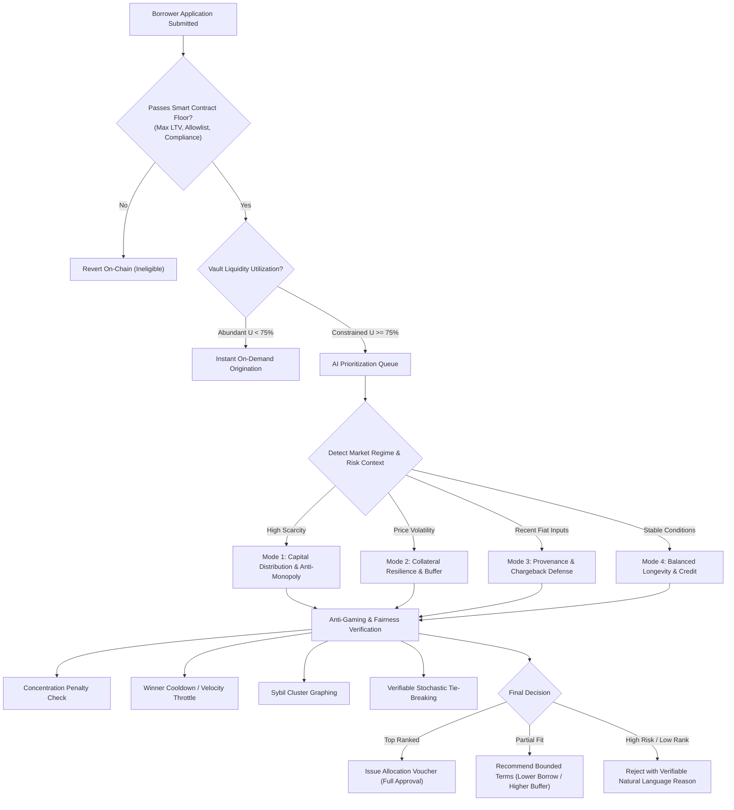

## Abstract

This document defines the functional protocol component specification for the **AI-Managed Lending Platform (AMLP)** on the **XRP Ledger (XRPL) EVM Sidechain**.

AMLP is a core protocol component within a broader financial application architecture, delivering decentralized, overcollateralized lending and borrowing. The system combines immutable smart contract risk enforcement with an autonomous, bounded **AI Lending Agent**. The smart contract suite sovereignly governs all financial accounting, collateral custody, loan-to-value (LTV) limits, health factor thresholds, and liquidation settlements. The off-chain AI Lending Agent provides predictive monitoring, prioritization of scarce pool liquidity, optimal liquidation coordination, and post-liquidation recovery reconciliation without possessing custodial access or the ability to override deterministic contract invariants.

---

## Motivation

Decentralized lending protocols have traditionally relied on purely reactive, uncoordinated liquidation keepers and static risk parameters. While functional under benign market conditions, this paradigm reveals severe structural vulnerabilities during rapid market drawdowns:

1. **Uncoordinated Liquidation Cascades**: Independent third-party searchers race to liquidate identical positions simultaneously, causing gas fee spikes, network congestion, high slippage on decentralized exchanges (DEXs), and failed transactions that result in protocol bad debt.
2. **Capital Inefficiency During Liquidity Crunches**: Traditional pools treat borrow requests on a blind First-Come, First-Served (FCFS) basis. When capital utilization approaches 100%, high-quality borrowers with superior collateral margins are rejected while lower-margin loans consume the remaining pool reserves.
3. **Delayed Recovery and Unreconciled Debt Accounting**: When partial fills or DEX slippage cause debt shortfalls, protocols often leave bad debt dormant in pool accounting, distorting utilization rates and eroding depositor yields.
4. **Static Risk Inflexibility**: Risk parameters (LTV, liquidation thresholds, borrow caps) remain static for extended periods due to slow governance processes, making protocols either excessively conservative during stable markets or dangerously exposed during volatile regimes.

### The Case for Bounded Autonomous Risk Coordination

Deploying on the **XRPL EVM Sidechain** enables micro-transaction costs and fast finality. However, achieving capital efficiency requires replacing reactive searcher free-for-alls with **coordinated, intelligent risk management**.

This specification introduces a formal separation between **deterministic cryptographic enforcement** and **agentic heuristic reasoning**:
- **Smart contracts must be completely sovereign**: No off-chain entity, including an artificial intelligence agent or administrator, shall have the capability to extract funds, liquidate solvent loans, alter collateral requirements beyond predefined bounds, or bypass programmatic solvency formulas.
- **The AI agent must be strictly bounded**: The agent operates as an intelligent coordinator that monitors telemetry, prioritizes loan applications when liquidity is constrained, orchestrates liquidations to minimize market impact, and verifies post-settlement accounting.

### Architectural Goals

This component specification establishes the following core requirements:
- **Deterministic Solvency Enforcement**: Enforcing on-chain health factor computations derived from validated XRPL EVM price feeds.
- **Multi-Collateral Isolation & Escrow**: Segregating deposited collateral into auditable vaults with independent risk weights.
- **Bounded Agent Permissions**: Defining exact cryptographic interfaces (EIP-712 typed intents) through which the AI agent submits coordinated actions.
- **Transparent Decision Auditability**: Exposing every agent decision, priority ranking, and reconciliation action to an on-chain event stream and public monitoring interface.
- **Zero-Shortfall Recovery Waterfall**: Establishing a strict mathematical order of operations for liquidation settlements, protocol reserves, and bad-debt isolation.

---

## Specification

The key words "MUST", "MUST NOT", "REQUIRED", "SHALL", "SHALL NOT", "SHOULD", "SHOULD NOT", "RECOMMENDED", "MAY", and "OPTIONAL" in this document are to be interpreted as described in [RFC 2119](http://tools.ietf.org/html/rfc2119).

---

### Protocol Actors

The platform defines distinct operational actors, each possessing strictly segregated permissions:

| Actor | Functional Role & Permitted Boundaries |
| :--- | :--- |
| **Lender (Liquidity Supplier)** | Deposits supported base stablecoins (RLUSD) into the lending vault to provide liquidity; receives interest-bearing pool receipt shares and redeems them subject to pool availability. |
| **Borrower** | Pledges approved collateral (via direct EVM ERC-20 transfer or cross-chain native XRPL escrow lock) and draws stablecoin debt against their collateral subject to strict LTV limits. |
| **AI Lending Agent** | Authorized off-chain autonomous risk coordinator; monitors loan health, prioritizes borrow requests during capital crunches, orchestrates liquidations, and reconciles post-liquidation recovery. Holds zero custodial or withdrawal authority. |
| **Fiat Payment Gateway Signer** | Regulated financial institution (integrated with Mastercard API & BVNK rails); verifies fiat clearing and issues cryptographically signed settlement vouchers without touching smart contract gas wallets. |
| **Cross-Chain Witness / Relayer Network** | Decentralized validator committee (leveraging Axelar General Message Passing and XRPL ledger monitors); attests to native XRP Ledger escrow locks and relays fulfillment triggers. |
| **Protocol Operator (Multisig Governance)** | Multi-signature administrator holding timelocked authority to configure asset risk parameters, register oracle adapters, and execute emergency circuit breaker resumption. |

---

### Lender Operations & Liquidity Management

Lenders provide the foundational stablecoin liquidity required for the platform's credit facilities.

#### 1. Supplying Liquidity & Pool Share Accounting
- Lenders deposit supported base stablecoins (such as **RLUSD**) directly into the main lending pool.
- Upon deposit, the smart contract mints interest-bearing liquidity shares (`amRLUSD`) to the lender's account. These shares represent a proportional claim on the pool's total underlying assets, which include both unborrowed cash reserves and active, interest-accruing borrower debt.
- The conversion exchange rate between pool shares and the underlying stablecoin appreciates continuously as borrowers repay accrued interest:
  $$\text{Shares Minted} = \frac{\text{Amount Deposited} \times \text{Total Shares Outstanding}}{\text{Total Pool Liquid Cash} + \text{Total Borrowed Debt} - \text{Protocol Reserves}}$$

#### 2. Dynamic Jump-Rate Utilization Model
The interest rates charged to borrowers and paid to lenders adjust automatically each block based on capital utilization ($U$), defined as the ratio of borrowed debt to total supplied liquidity:

$$U = \frac{D_{\text{total}}}{L_{\text{supplied}}}$$

The borrow interest rate ($R_t$) follows a two-slope jump-rate curve designed to maintain optimal pool liquidity:

$$R_t = \begin{cases} 
R_0 + \left(\frac{U}{U_{\text{optimal}}}\right) \times R_1 & \text{if } U \le U_{\text{optimal}} \\
R_0 + R_1 + \left(\frac{U - U_{\text{optimal}}}{1 - U_{\text{optimal}}}\right) \times R_2 & \text{if } U > U_{\text{optimal}}
\end{cases}$$

Where:
- $U_{\text{optimal}}$ is the target capital utilization benchmark (e.g., $80\%$).
- $R_0$ is the base interest rate charged when utilization is near zero (e.g., $2\%$).
- $R_1$ is the slope 1 interest multiplier, representing steady-state borrowing costs (e.g., $4\%$).
- $R_2$ is the jump multiplier, sharply escalating borrowing rates when utilization exceeds $80\%$ (e.g., $60\%$) to incentivize new lender deposits and prompt borrowers to repay outstanding debt.

The supply annual percentage yield (APY) earned by lenders is derived directly from the borrow rate, discounted by the current utilization and the protocol reserve factor:

$$\text{Supply Rate} = R_t \times U \times (1 - \text{ReserveFactor})$$

Where $\text{ReserveFactor}$ (e.g., $10\%$) is diverted to the Protocol Bad-Debt Reserve Fund.

---

### Borrower Operations, Solvency & Dynamic Allocation

Borrowers lock collateral to unlock borrowing power, manage ongoing debt balances, and undergo dynamic eligibility evaluation when pool capital is constrained.

#### 1. Collateral Custody & Multi-Asset Valuation
- Collateral assets are held in segregated, non-custodial vault storage isolated from the active lending pool.
- Each approved collateral token is assigned explicit risk parameters:
  - **Maximum Loan-to-Value ($\text{LTV}_{\text{max}}$)**: The maximum debt that can be originated against the collateral value (e.g., $70\%$).
  - **Liquidation Threshold ($\text{LT}$)**: The risk boundary where a position becomes undercollateralized and liquidatable (e.g., $80\%$).
  - **Liquidation Penalty ($\text{LP}$)**: The discount awarded to liquidators for repaying distressed debt (e.g., $5\%$).

#### 2. Position Solvency & Health Factor ($H_f$) Computation
A borrower's position solvency is continuously evaluated on-chain by the Risk Engine. A loan's Health Factor ($H_f$) is defined as the ratio of liquidation-adjusted collateral value to outstanding total debt:

$$H_f = \frac{\sum_{i=1}^{N} \left( C_i \times P_i \times \frac{\text{LT}_i}{10000} \right)}{D_{\text{total}} \times P_{\text{base}}}$$

Where:
- $N$ is the number of distinct collateral assets deposited by the borrower.
- $C_i$ is the quantity of collateral asset $i$ locked in vault escrow.
- $P_i$ is the real-time USD price of collateral asset $i$ reported by validated oracle feeds.
- $\text{LT}_i$ is the liquidation threshold in basis points for asset $i$ ($8000 = 80\%$).
- $D_{\text{total}}$ is the borrower's total outstanding debt principal plus accrued interest.
- $P_{\text{base}}$ is the USD price of the base borrow currency ($1.00$ for stablecoins).

##### Position Lifecycle States:
- **`HEALTHY` ($H_f \ge 1.05$)**: The position has a safe collateral buffer. The borrower may borrow additional funds (up to $\text{LTV}_{\text{max}}$) or withdraw excess collateral.
- **`AT_RISK` ($1.00 \le H_f < 1.05$)**: The position is nearing undercollateralization. Borrowing and collateral withdrawals are blocked by smart contracts. The AI agent alerts the borrower to add collateral or repay debt.
- **`LIQUIDATION_ELIGIBLE` ($H_f < 1.00$)**: The collateral value has fallen below the safety threshold. Smart contracts deterministically unlock the position for liquidation.

#### 3. Comprehensive Borrower Eligibility & Dynamic Allocation
When the protocol has abundant funds, credit is disbursed on-demand. However, because lending vaults operate with finite capital, the protocol cannot fulfill all borrow requests during liquidity crunches or high-demand periods. 

Borrower eligibility operates under a two-tiered model:



##### Dual-Regime Operation:
1. **Deterministic Smart Contract Baseline**: Regardless of AI reasoning, no applicant can ever borrow unless their application satisfies the smart contract floor (approved collateral asset, borrow request within 70% LTV, protocol vault holding liquid cash, and sanctioned address checks passing).
2. **Regime A (Abundant Liquidity, $U < 75\%$ )**: When vault liquidity is plentiful, eligible borrowers draw funds on-demand in the same transaction block without queueing.
3. **Regime B (Constrained Liquidity, $U \ge 75\%$ )**: When unborrowed pool cash is low or halfway depleted, the protocol shifts to the AI Prioritization Queue. The AI agent assesses competing applications and issues cryptographically signed allocation vouchers to the highest-ranking borrowers.

##### Dynamic Multi-Factor Reasoning Modes:
To prevent applicants from reverse-engineering a single static metric, the AI agent dynamically weights its evaluation methodology based on real-time market context:

```mermaid
flowchart TD
    Req["Incoming Borrow Request (Entity X)"] --> MarketContext{"What is the Current Regime?"}

    MarketContext -->|Regime 1: Liquidity Crunch\n(Vault > 75% Utilized)| EvalCrunch["Mode 1: Capital Distribution & Anti-Monopoly"]
    MarketContext -->|Regime 2: Macro Volatility Spike\n(High Token Swings)| EvalVol["Mode 2: Collateral Resilience & Volatility Buffer"]
    MarketContext -->|Regime 3: Fiat Settlement Anomaly\n(Recent Banking Dispute)| EvalProv["Mode 3: Provenance & Chargeback Defense"]
    MarketContext -->|Regime 4: Normal Market Conditions| EvalBalanced["Mode 4: Balanced Credit & Longevity"]

    EvalCrunch --> AntiGaming["Anti-Gaming & Fairness Layer"]
    EvalVol --> AntiGaming
    EvalProv --> AntiGaming
    EvalBalanced --> AntiGaming

    AntiGaming --> Check1["1. Concentration Penalty Check\n(Penalize draining >25% of pool)"]
    AntiGaming --> Check2["2. Sybil & Cluster Detection\n(Linked wallet graphing)"]
    AntiGaming --> Check3["3. Velocity Throttle\n(Diminishing priority for repeat winners)"]
    AntiGaming --> Check4["4. Verifiable Stochastic Tie-Breaking\n(Prevents bot timing exploits)"]

    Check1 & Check2 & Check3 & Check4 --> FinalDecision["Final Bounded Score & Reasoning Hash"]
```

* **Mode 1: Capital Distribution & Anti-Monopoly Mode (Scarcity Focus)**: When pool funds are low, the agent penalizes outsized borrow requests that attempt to consume a dominant fraction of remaining cash. Smaller, diversified loans to multiple entities receive priority over letting a single whale drain the vault.
* **Mode 2: Collateral Resilience & Volatility Mode (Market Crash Focus)**: During sharp crypto drawdowns, the agent prioritizes applicants offering deep overcollateralization buffers (e.g., borrowing at 35%–45% LTV rather than pushing the 70% maximum).
* **Mode 3: Collateral Provenance & Chargeback Defense Mode (Settlement Risk Focus)**: When deposits involve fiat payment gateways, the agent analyzes the settlement age and payment method. Mathematically irrevocable assets (native on-chain XRPL escrows) receive zero-chargeback classification, whereas fresh card/ACH deposits within active bank clawback windows are capped or deprioritized until settlement has seasoned.
* **Mode 4: Balanced Longevity & Credit Mode (Normal Market Focus)**: In stable conditions, the agent rewards consistent historical repayment velocity and predictable loan terms.

##### Anti-Gaming and Anti-Monopoly Safeguards:
1. **Borrower Concentration Penalty**:
   $$\text{PenaltyFactor} = \left(\frac{\text{Requested Borrow Amount}}{\text{Total Available Vault Liquidity}}\right)^2$$
   Requests attempting to take an outsized fraction of unreserved vault cash are exponentially penalized, preventing single-entity pool monopolization.
2. **Winner Cooldown & Velocity Throttling**: Entities awarded loan vouchers undergo an automatic priority cooldown, allowing waiting competitors to access liquidity.
3. **Sybil Cluster & Linked Wallet Detection**: The agent analyzes on-chain transaction graphs to identify synthetic wallet clusters, treating coordinated addresses as a single unified entity against pool borrow caps.
4. **Verifiable Stochastic Tie-Breaking**: When multiple legitimate borrowers achieve scores within a 5% margin, a deterministic pseudo-random tie-breaker salted with the latest finalized block hash prevents bots from gaming exact priority scores.

##### Bounded Decision Outcomes:
- **Full Approval**: The agent signs a `LoanAllocationVoucher` defining the approved amount, priority score, expiration deadline (e.g., 60 minutes), and the IPFS hash of the reasoning audit trail.
- **Conditional / Recommended Adjusted Terms**: When a request cannot be funded in full, the agent proposes a smaller borrow amount or higher collateral buffer that can be safely accommodated.
- **Transparent Rejection**: Rejections produce an auditable natural-language explanation published to the monitoring dashboard explaining the exact reason (e.g., unseasoned fiat settlement, vault concentration threshold reached).

---

### Deposit Options & Cross-Chain Ingestion

The protocol provides four distinct deposit paths accommodating pure EVM stablecoin liquidity, fiat payment rails, native XRPL cross-chain collateral, and additional EVM tokens.

```mermaid
flowchart TD
    subgraph PathA ["Path 1: Direct EVM Stablecoin (MVP Core)"]
        UserA["EVM User / LP"] -->|Direct ERC-20 Deposit (RLUSD)| PoolCore["LendingPool.sol"]
        PoolCore -->|Instant Mint| SharesA["amRLUSD Yield Shares"]
    end

    subgraph PathB ["Path 2: Fiat On-Ramp with Confirmed Settlement"]
        UserB["Fiat Depositor"] -->|USD / EUR / GBP| PayGateway["Fiat Payment Provider"]
        PayGateway -->|FX Quotation| MastercardAPI["Mastercard Currency Conversion API"]
        MastercardAPI -->|Confirmed RLUSD Rate| PayGateway
        PayGateway -->|Wait for ACH / Card Finality| SettlementLock["Off-Chain Settlement Confirmation"]
        SettlementLock -->|Signed Settlement Voucher| OnRampContract["FiatOnRampGateway.sol"]
        OnRampContract -->|Credit Deposit Post-Settlement| PoolCore
    end

    subgraph PathC ["Path 3: Native XRPL Collateral Verification & Bridging"]
        UserC["XRPL Native Holder"] -->|Lock XRP / IOUs in Escrow| XRPLEscrow["XRPL Mainchain Native Escrow"]
        XRPLEscrow -->|Ledger Close Proof & Event| WitnessNet["XRPL-EVM Witness / Relayer Network"]
        WitnessNet -->|Threshold BLS/ECDSA Attestation| NativeAdapter["NativeCollateralVault.sol (EVM)"]
        NativeAdapter -->|Credit Collateral Claim| RiskEngineCore["RiskEngine.sol"]
    end

    subgraph PathD ["Path 4: Additional EVM Token Verification Pipeline"]
        TokenAdmin["Asset Onboarding"] -->|Static & Dynamic Analysis| TokenVerifier["TokenVerificationGate.sol"]
        TokenVerifier -->|Verify No Fee-on-Transfer / Non-Reentrant| Allowlist["Collateral Allowlist"]
        Allowlist -->|Register Dual Oracle Feeds| OracleRegistry["PriceOracleAdapter.sol"]
    end
```

#### 1. Path 1: Direct EVM Stablecoin Deposits (MVP Focus)
- Supports direct single-transaction deposits of approved EVM stablecoins (**RLUSD**).
- Transferring tokens directly into the lending pool instantly mints `amRLUSD` liquidity shares.
- Involves zero bridge delay, no off-chain oracle dependency, and immediate yield accrual.

#### 2. Path 2: Fiat On-Ramp via Mastercard & Regulated Payment Providers (Method B: Voucher Relay)
- **Method B Exclusivity**: Payment providers operate strictly as off-chain cryptographic signers. Gateways are not required to maintain hot gas wallets on the XRPL EVM Sidechain.
- **Confirmed Settlement Prerequisite**: No funds are ever credited or minted prior to irrevocable fiat settlement confirmation (e.g., ACH clearance or payment capture).
- **Mastercard FX Integrity**: The gateway verifies conversion rates against the **Mastercard Currency Conversion API**. Any rate quote deviating by more than $\pm 0.50\%$ from the benchmark is aborted.
- **Settlement Voucher Schema**: Upon confirmed settlement, the gateway issues a cryptographic `FiatSettlementVoucher` containing the recipient address, fiat currency code, fiat amount, converted RLUSD amount, unique gateway transaction ID, and expiration timestamp.
- **Hardcoded Vault Destination & Unbounded Relay**:
  - The voucher is submitted to the on-ramp gateway contract by the AI Lending Agent (via automated tool call) or directly by the user.
  - The gateway contract contains an **immutable destination address** permanently locked to the lending pool vault. 100% of converted RLUSD flows directly into pool reserves; no caller can divert funds to arbitrary addresses.
  - The AI agent operates with **unbounded throughput** on voucher amounts, as the cryptographic voucher and hardcoded destination prevent unauthorized fund diversion.
- **AI Agent Settlement Audit**: The AI agent cross-references banking settlement webhooks against on-chain pool credit events every 15 minutes, alerting operators of any discrepancy.

#### 3. Path 3: Native XRPL Collateral Verification & Bridging Engine
- **Non-Custodial Escrow on Native XRP Ledger**: Borrowers holding native XRPL assets (XRP or issued trustline tokens) lock collateral directly on the XRP Ledger using the native `EscrowCreate` transaction.
- **Crypto-Condition Binding**:
  - The escrow is locked with a cryptographic condition: $\text{Condition} = \text{SHA-256}(S)$, where $S$ is a 32-byte secret generated by the platform bridge.
  - The escrow destination is set to the protocol's XRPL Settlement Door.
  - The transaction `Memos` field encodes the borrower's XRPL EVM address.
- **Axelar General Message Passing (GMP) & Witness Attestation**:
  - The official cross-chain interoperability network (Axelar GMP relayer nodes and BFT witnesses) monitors XRPL ledger closes and certifies the lock.
  - The attestation is submitted to the bridge adapter on XRPL EVM, which credits virtual native collateral in the vault and elevates borrowing capacity.
- **Loan Repayment & Remote Release**:
  - Upon full repayment on XRPL EVM, the bridge contract reveals preimage $S$.
  - An `EscrowFinish` transaction containing preimage $S$ is submitted on XRPL, unlocking the native collateral back to the borrower's XRPL account.
- **Remote Liquidation Execution**:
  - If liquidated on EVM, the liquidator settles the stablecoin debt in the pool and receives the right to claim the native XRPL escrow.
  - The liquidator executes `EscrowFinish` on the native XRPL mainnet to claim the XRP.

#### 4. Path 4: Additional EVM Token Verification Pipeline
- Before any new ERC-20 collateral asset is approved, it must pass a strict verification gate:
  - *Standard Compliance*: Rejects tokens with fee-on-transfer, rebasing supply, or non-standard transfer mechanics.
  - *Oracle Redundancy*: Requires at least two independent on-chain price feeds (e.g., Pyth + Band) with freshness heartbeats $\le 300\text{ seconds}$.
  - *Conservative Risk Bounds*: New assets are initialized with $\text{LTV} \le 60\%$ and protocol-wide supply caps.

---

### Withdraw Requirements & Solvency Constraints

Withdrawals allow lenders to exit liquidity and borrowers to reclaim surplus collateral, subject to strict solvency conditions.

#### 1. Lender Liquidity Redemption
- Lenders redeem `amRLUSD` pool shares for underlying stablecoins at the current exchange rate.
- **Liquidity Availability Condition**: Redemptions are fulfilled instantaneously provided pool utilization $U < 100\%$. If all liquidity is currently borrowed, redeeming lenders queue until borrowers repay debt or new deposits arrive.
- Redeemed shares are burned, and the corresponding stablecoin principal plus accrued interest is transferred to the lender.

#### 2. Borrower Collateral Release & Solvency Invariant
- A borrower may withdraw deposited collateral at any time, provided the remaining collateral maintains the position's solvency.
- **Safety Margin Rule**: The smart contract calculates the position's projected health factor after the proposed withdrawal. The transaction is rejected if the resulting health factor would drop below $H_f < 1.05$.
- For native XRPL collateral, requesting a withdrawal on EVM initiates a partial preimage release, unlocking the corresponding portion of the native XRPL escrow back to the borrower's XRPL account.

#### 3. Emergency Withdrawal Protections
- In the event that governance triggers an emergency pause, borrowing is halted immediately, but **orderly lender withdrawals and borrower debt repayments remain active**.
- If a specific collateral asset experiences extreme distress, governance can invoke an isolated asset freeze, preventing new collateral deposits of that asset while allowing existing borrowers to repay and withdraw safely.

---

### Agent Management & Risk Coordination

The AI Lending Agent is an autonomous off-chain risk coordinator with strictly bounded execution privileges.

#### 1. Separation of Powers Matrix

| Operational Area | Hardcoded Smart Contract Invariants (Inviolable) | AI Agent Autonomous Reasoning (Bounded) |
| :--- | :--- | :--- |
| **Loan Monitoring & Liquidation** | - Reverts if $H_f \ge 1.00$<br>- Enforces close factor $\le 50\%$ ($100\%$ if $H_f < 0.90$)<br>- Enforces liquidation bonus caps ($\le 10\%$)<br>- Reverts if oracle price is stale ($\Delta t > \text{MaxDelay}$)<br>- Collateral seized goes only to liquidator / pool | - Continuously tracks position health factors<br>- Simulates 1h and 4h price volatility<br>- Evaluates on-chain DEX slippage before liquidating<br>- Prioritizes at-risk positions approaching threshold<br>- Dynamically optimizes gas fees to ensure sub-block inclusion |
| **Borrower Eligibility & Requests** | - Enforces maximum 70% LTV<br>- Enforces token allowlists & pool borrow caps<br>- Reverts if unreserved pool liquidity is zero<br>- Verifies compliance sanction flags | - Activates queue when vault utilization $U \ge 75\%$<br>- Dynamically shifts between 4 reasoning modes<br>- Applies anti-gaming concentration penalties<br>- Generates transparent natural-language justifications |
| **Recovery Reconciliation** | - Enforces strict repayment waterfall order<br>- Prevents double-accounting of bad debt<br>- Regulates protocol reserve fund debits<br>- Emits immutable audit event logs | - Verifies settled transactions match pool balance changes<br>- Detects partial-fill shortfalls and DEX slippage gaps<br>- Coordinates automated retries for reverted executions<br>- Dispatches multisig alerts for discrepancies $> \$50$ |
| **Pool Telemetry & Health** | - Enforces jump-rate utilization curve<br>- Executes emergency pause circuit breakers<br>- Reverts state-mutating actions during pause | - Aggregates real-time TVL, debt, and APR metrics<br>- Emits WebSocket and REST telemetry event streams<br>- Delivers proactive risk parameter advisory to governance |

#### 2. Liquidation Mechanics & Mathematical Waterfall
When a loan position crosses into undercollateralization ($H_f < 1.00$), the AI agent or an external searcher initiates a liquidation.

##### Close Factor ($CF$):
To prevent over-liquidation of slightly distressed positions, the maximum repayable debt in a single transaction is bounded by the Close Factor:

$$CF = \begin{cases} 
0.50 & \text{if } H_f \ge 0.90 \\
1.00 & \text{if } H_f < 0.90 \text{ (Deep Insolvency Override)}
\end{cases}$$

$$\text{MaxRepayableDebt} = D_{\text{total}} \times CF$$

##### Collateral Seizure Formula:
The amount of collateral seized by the liquidator is calculated based on the debt repaid, discounted by the liquidation bonus ($\text{LP}$):

$$\text{CollateralSeized} = \frac{\text{DebtRepaid} \times P_{\text{base}} \times \left(1 + \frac{\text{LP}}{10000}\right)}{P_{\text{collateral}}}$$

##### Settlement Waterfall:
All proceeds and state modifications follow a deterministic order of operations:
1. **Collateral Debit**: Seized collateral is debited from the borrower's vault balance.
2. **Liquidator Bonus**: The net seized collateral (less protocol fees) is transferred to the liquidator.
3. **Protocol Reserve Allocation**: A portion of the liquidation bonus (e.g., $10\%$) is deposited into the Protocol Reserve Vault.
4. **Debt Extinguishment**: The repaid debt principal is extinguished from the borrower's ledger in the lending pool.
5. **Liquidity Replenishment**: The repaid base currency is credited back into available pool liquidity.
6. **Bad-Debt Check**: If all collateral is exhausted but debt remains ($H_f < 1.00$ with zero collateral), the position enters `DEFAULTED` state. The smart contract isolates the shortfall and draws from the Protocol Reserve Fund to keep pool depositors whole.

#### 3. Cryptographic Intent Standards (EIP-712)
All actions coordinated by the AI Lending Agent are authorized using EIP-712 typed structured data signatures:
- **Domain Binding**: Binds all signatures to the specific contract address and chain ID (`1449000` on Testnet, `1440001` on Mainnet), preventing cross-network replay attacks.
- **Replay Protection**: Each intent incorporates a sequential nonce and an absolute expiration deadline ($\le 60\text{ seconds}$ for liquidations, $\le 60\text{ minutes}$ for borrow allocation vouchers).
- **Audit Anchoring**: Vouchers include a cryptographic hash (`reasoningHash`) pointing to an immutable off-chain audit record detailing the AI agent's complete natural-language reasoning.

---

## Security Considerations

### 1. Bounded Blast Radius & Principle of Least Privilege
The primary systemic risk in AI-integrated protocols is model compromise or prompt injection leading to erroneous contract interactions.
- **Mitigation**: The AI Lending Agent possesses **zero withdrawal or transfer authority**. The smart contracts execute independent mathematical checks before every state transition. Even if an attacker gains total control of the agent's private signing key, the attacker cannot liquidate solvent positions ($H_f \ge 1.00$), redirect seized collateral to unauthorized accounts, withdraw stablecoins from the pool, or approve loans exceeding the 70% LTV cap.

### 2. Oracle Stale Data & Flash Manipulation Defenses
- All price queries in the Risk Engine verify that $\text{block.timestamp} - \text{lastPriceUpdate} \le \text{MaxAllowedDelay}$ ($\le 300\text{ seconds}$).
- If an oracle feed violates heartbeat thresholds, borrowing, withdrawals, and liquidations for that asset revert immediately.
- Dual-oracle medianization (e.g., Pyth + Band) is enforced for high-value liquidations to prevent single-feed manipulation.

### 3. Frontrunning & MEV Exploits on XRPL EVM
- Third-party searchers in the mempool may attempt to frontrun agent-submitted liquidations.
- **Mitigation**: Liquidation intents incorporate strict slippage protection parameters (`minCollateralExpected`) and short validity deadlines. The contract also supports priority routing for the authorized agent address.

### 4. Reentrancy and Cross-Contract Vault Safety
- All smart contracts handling asset custody implement non-reentrant guards on all external state-mutating functions.
- All balance updates follow the Checks-Effects-Interactions pattern.

### 5. Emergency Circuit Breakers (Asymmetric Pausing)
- A designated Guardian role allows both the automated AI monitor and human multisig governance to instantly trigger emergency pause tiers (`PAUSE_BORROWING`, `FREEZE_ASSET`).
- **Asymmetric Authority**: The AI agent may trigger an emergency pause when extreme market anomalies are detected, but **cannot unpause the protocol**. Resumption of operations requires the cryptographic authorization of the Human Multisig Governance.

### 6. Cross-Chain Collateral Bridge Security & Crypto-Condition Safety
- **Escrow Expiration Lockout**: Native XRPL escrows specify a `CancelAfter` timestamp. To prevent a borrower from canceling an escrow while an active EVM loan remains outstanding, the Risk Engine enforces that loan maturity must be at least 24 hours prior to the escrow cancellation timeout:
  $$\text{LoanExpiry} \le \text{CancelAfter} - 86400\text{ seconds}$$
- **Witness Collusion Resistance**: The witness relayer network validating XRPL ledger proofs utilizes a $2/3 + 1$ Byzantine Fault Tolerant threshold scheme.
- **Single-Slot Finality**: XRPL ledger consensus provides deterministic single-slot finality without probabilistic reorgs, eliminating the risk of reorg-induced collateral double-spends.

### 7. Fiat On-Ramp Chargeback & Settlement Asynchrony Defenses
- **Irrevocable Clearing Rule**: Vouchers are strictly forbidden from being minted until fiat payments have cleared the banking network's reversal window.
- **Gateway Reserve Escrow**: Regulated payment providers maintain a collateral bond in the protocol reserve to cover any clawbacks or banking disputes that occur post-settlement.

---

## Copyright

Copyright and related rights waived via [CC0 1.0 Universal](https://creativecommons.org/publicdomain/zero/1.0/).

---

## References

1. **RFC 2119**: Key words for use in RFCs to Indicate Requirement Levels.
2. **COSS/1**: Consensus-Oriented Specification System.
3. **EIP-712**: Typed structured data hashing and signing.
4. **EIP-20**: Token Standard.
5. **XRPL EVM Sidechain Documentation**: Ripple / Peersyst Technology XRPL EVM Sidechain Architecture.
6. **Compound Finance & Aave v3 Protocols**: Liquidation and interest rate jump-model technical papers.
7. **Mastercard Developers API**: Currency Conversion and FX Cross-Border APIs.
8. **Interledger / Crypto-Conditions**: RFC draft-thomas-crypto-conditions-04.
9. **XLS-38d Standard**: Cross-Chain Bridges Amendment for XRP Ledger (`XChainCommit`, `XChainClaim`).
10. **Axelar Network Cross-Chain Standard**: General Message Passing (GMP) Protocol for XRPL EVM Sidechain.
