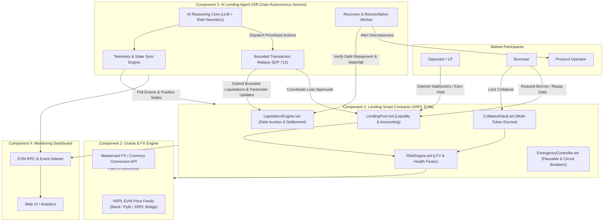
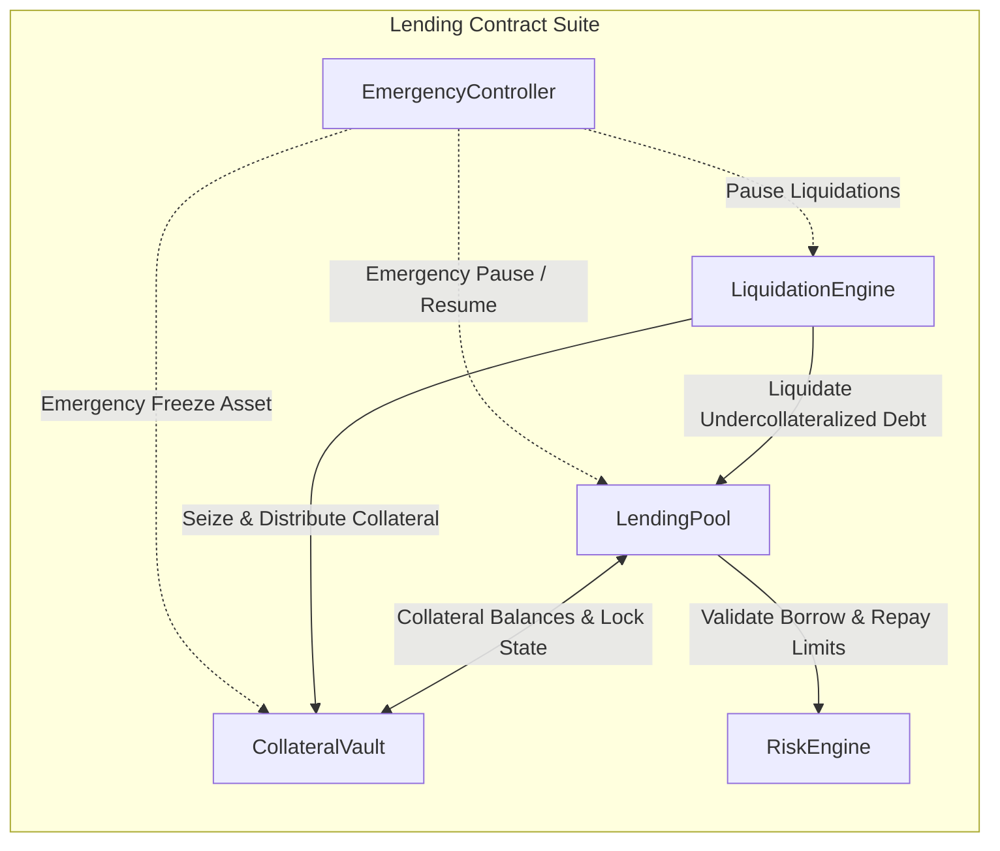
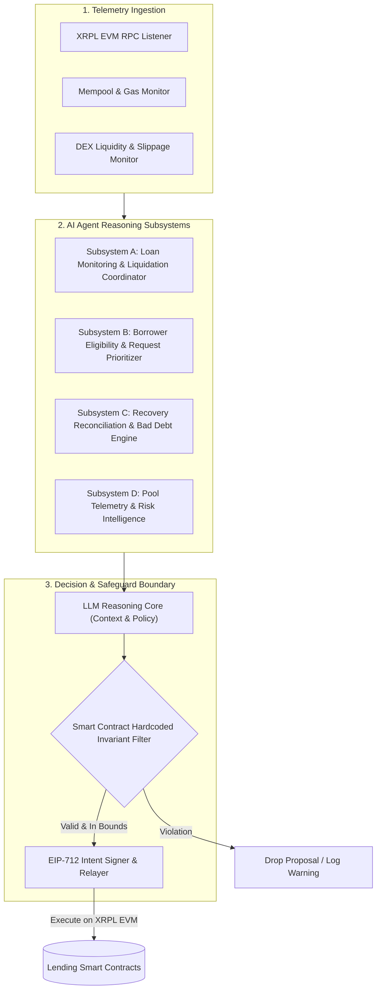
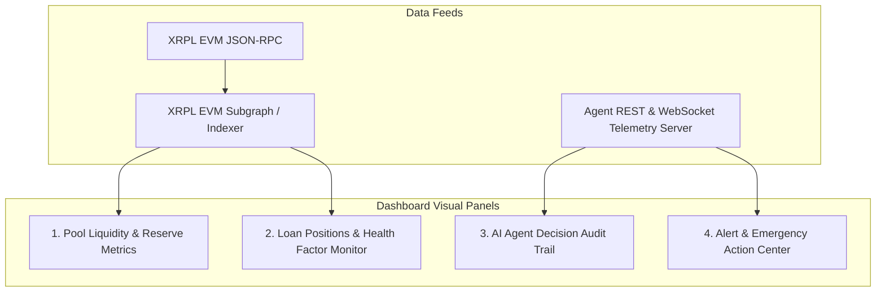
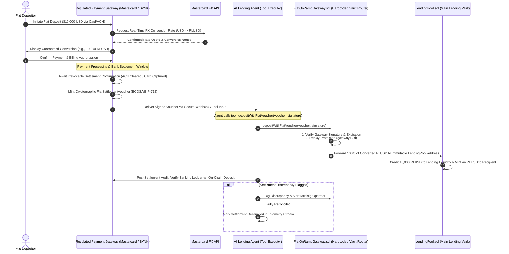
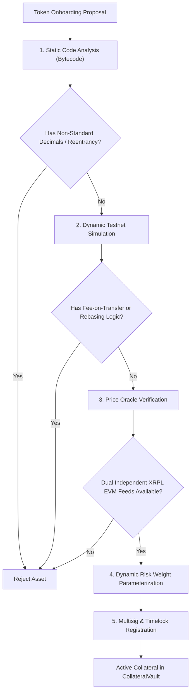

# Technical Architecture Document: AI-Managed Lending Platform on XRPL EVM

---

## 1. Executive Summary

The **AI-Managed Lending Platform (AMLP)** is an autonomous, non-custodial decentralized finance (DeFi) credit protocol deployed on the **XRP Ledger (XRPL) EVM Sidechain**. The protocol enables depositors to earn yield on supported stablecoins, allows borrowers to draw liquidity against overcollateralized multi-token vaults, and integrates an autonomous **AI Lending Agent** to perform continuous risk monitoring, liquidation orchestration, loan prioritization, and post-liquidation recovery reconciliation.

A non-negotiable core architectural invariant of the platform is the **Separation of Powers**:
* **Smart Contracts are Sovereign**: All financial state transitions, solvency checks, collateral requirements, liquidation rules, loan-to-value (LTV) limits, and access controls are **hardcoded and deterministically enforced** on-chain.
* **AI Agent is Bounded**: The AI agent reasons over multi-dimensional market telemetry, borrower request queues, and liquidation urgency to prioritize and coordinate actions. The agent holds strictly bounded execution privileges and cannot bypass smart contract risk rules or withdraw protocol funds.



---

## 2. System Architecture & Component Breakdown

### 2.1 Component 1: Lending Smart Contracts (XRPL EVM)

The smart contract layer is deployed on the XRPL EVM Sidechain using Solidity (`^0.8.24`) compiled via EVM Shanghai/Cancun target, leveraging EVM compatibility while inheriting fast finality and low transaction costs.



#### 2.1.1 `LendingPool.sol` (Pool Core)
- **Role**: Manages supplied liquidity, mints interest-bearing liquidity receipt tokens (`poolToken`, e.g., `amRLUSD`), coordinates borrowing, and tracks user debt balances.
- **MVP Asset Focus**: Direct deposits and borrowing of one primary EVM stablecoin (e.g., Ripple USD - **RLUSD** or bridged stablecoin).
- **Interest Rate Model**: Two-slope jump-rate utilization model:
  $$U = \frac{D_{\text{total}}}{L_{\text{supplied}}}$$
  $$R_t = \begin{cases} 
  R_0 + \frac{U}{U_{\text{optimal}}} \times R_1 & \text{if } U \le U_{\text{optimal}} \\
  R_0 + R_1 + \frac{U - U_{\text{optimal}}}{1 - U_{\text{optimal}}} \times R_2 & \text{if } U > U_{\text{optimal}}
  \end{cases}$$
  Where:
  - $U$ is current capital utilization.
  - $U_{\text{optimal}}$ is target utilization (e.g., 80%).
  - $R_0$ is base borrow rate (e.g., 2%).
  - $R_1$ is slope 1 rate (e.g., 4%).
  - $R_2$ is jump multiplier rate (e.g., 60%).

#### 2.1.2 `CollateralVault.sol` (Multi-Collateral Escrow)
- **Role**: Segregated, non-custodial custody of permitted collateral assets.
- **Multi-Token Accounting**: Supports multiple registered ERC-20 assets (e.g., wrapped XRP `wXRP`, wrapped Bitcoin `wBTC`, wrapped Ethereum `wETH`, and stable pairs).
- **Internal Ledger**:
  - Tracks user balances per asset: `mapping(address => mapping(address => uint256)) internal userCollateral`.
  - Distinguishes between free collateral and locked collateral backing active borrows.
  - Cross-margin aggregation or isolated vault mode selectable per asset risk tier.

#### 2.1.3 `RiskEngine.sol` (Risk & Solvency Enforcement)
- **Role**: Mathematical engine computing position solvency, maximum borrowing capacity, and health factors. Smart contracts call `RiskEngine` synchronously during any borrow, collateral withdraw, or liquidation attempt.
- **Core Parameters (Per Asset)**:
  - $\text{LTV}_{\text{max}}$: Maximum Loan-to-Value ratio for new borrowings (e.g., 70%).
  - $\text{LT}$: Liquidation Threshold ratio (e.g., 80%).
  - $\text{LP}$: Liquidation Penalty / Bonus for liquidators (e.g., 5% to 10%).
  - $\text{ReserveFactor}$: Fraction of interest diverted to protocol bad-debt reserve (e.g., 10%).
- **Health Factor Formula**:
  $$H_f = \frac{\sum_{i=1}^{N} \left( C_i \times P_i \times \text{LT}_i \right)}{\sum_{j=1}^{M} \left( B_j \times P_j \right)}$$
  Where:
  - $C_i$ is collateral quantity of asset $i$.
  - $P_i$ is USD price of asset $i$ from `PriceOracle`.
  - $\text{LT}_i$ is the liquidation threshold of asset $i$.
  - $B_j$ is outstanding borrowed principal + accrued interest for borrow asset $j$.
  - $P_j$ is USD price of borrow asset $j$.
- **Invariants**:
  - If $H_f \ge 1.0$, position is **solvent** and cannot be liquidated.
  - If $H_f < 1.0$, position is **undercollateralized** and immediately eligible for liquidation on-chain.
  - A user cannot borrow or withdraw collateral if the resulting operation results in $H_f < 1.05$ (safety margin above liquidation threshold).

#### 2.1.4 `LiquidationEngine.sol` (Settlement & Waterfall)
- **Role**: Allows permitted liquidators (including the AI Lending Agent or external third-party searchers) to repay undercollateralized debt in exchange for discounted collateral.
- **Liquidation Mechanics**:
  - Repayment amount capped at close factor (e.g., up to 50% of outstanding debt in normal conditions, 100% in deep undercollateralization $H_f < 0.90$).
  - Collateral seized:
    $$\text{Collateral Seized} = \frac{\text{Debt Repaid} \times P_{\text{debt}} \times (1 + \text{LP})}{P_{\text{collateral}}}$$
  - **Repayment Waterfall**:
    1. Seized collateral is transferred to the liquidator or liquidated on pool behalf.
    2. Outstanding debt balance is extinguished in `LendingPool`.
    3. Accrued protocol fee fraction is deposited into the Protocol Reserve Vault.
    4. Remaining collateral remains in the borrower's vault balance.

#### 2.1.5 `EmergencyController.sol` (Circuit Breakers & Pausing)
- **Role**: Tiered circuit breaker providing defense-in-depth against market anomalies, oracle corruption, or smart contract exploits.
- **Execution Tiers**:
  - `PAUSE_BORROWING`: Temporarily halts new borrow originations.
  - `PAUSE_DEPOSITS`: Halts new capital deposits.
  - `PAUSE_LIQUIDATIONS`: Freezes liquidation calls in case of erratic oracle data.
  - `FREEZE_ASSET(token)`: Isolates a specific distressed collateral token while keeping other operations live.
  - `EMERGENCY_SHUTDOWN`: Total pause, allowing only orderly collateral withdrawal and debt repayment.
- **Access Control**: Multisig Operator, Timelock, and bounded AI Agent Guardian role (AI can trigger emergency pause under strict automated conditions, but *cannot* unpause without human multisig approval).

---

### 2.2 Component 2: Price Oracle & FX Engine

Reliable asset pricing is critical for valuation and solvency. The protocol employs a dual-source oracle adapter on XRPL EVM combined with an external foreign exchange API.

```mermaid
flowchart TD
    subgraph ExternalSources ["External Feeds & APIs"]
        PythBand["XRPL EVM On-Chain Oracles (Pyth / Band / XRPL Bridge)"]
        Mastercard["Mastercard Currency Conversion & FX API"]
    end

    subgraph OracleAdapter ["Oracle Engine (PriceOracleAdapter.sol)"]
        Aggregator["Price Validator & Medianizer"]
        FreshnessCheck{"Freshness & Heartbeat Check (Δt < MaxDelay?)"}
        DeviationCheck{"Circuit Breaker (Deviation < 10%?)"}
        Cache["Validated On-Chain Price Storage"]
    end

    PythBand --> Aggregator
    Mastercard -.->|FX Reference Data (EUR/GBP/USD to RLUSD)| Aggregator
    Aggregator --> FreshnessCheck
    FreshnessCheck -->|Pass| DeviationCheck
    FreshnessCheck -->|Stale| FallbackMode["Reject Query / Revert"]
    DeviationCheck -->|Pass| Cache
    DeviationCheck -->|Out of Bounds| AlertTrip["Trip Circuit Breaker & Fallback"]
```

#### 2.2.1 XRPL EVM On-Chain Feeds
- **Integrations**: Integrates available EVM-compatible oracle feeds on the XRPL EVM Sidechain (e.g., Pyth Network pull/push oracles, Band Protocol standard aggregators, or native XRPL cross-chain oracle bridges).
- **Parameters**:
  - `heartbeat`: Maximum acceptable elapsed time since last update (e.g., 300 seconds for volatile assets, 3600 seconds for stablecoins).
  - `deviationThreshold`: Price movement trigger (e.g., 0.5% price delta initiates feed update).
  - `confidenceInterval`: Minimum oracle confidence bounds; wide spreads trigger fallback mechanisms.

#### 2.2.2 Mastercard Currency Conversion API Integration
- **Role**: Provides off-chain institutional foreign exchange (FX) conversion rates, cross-currency settlements, and benchmark fiat conversion figures.
- **Use Cases**:
  - Cross-border fiat-to-stablecoin conversion valuation for the fiat on-ramp pipeline (converting USD, EUR, GBP into RLUSD).
  - Secondary verification reference for stablecoin peg parity checks ($1.00 \text{ RLUSD} \approx \$1.00 \text{ USD}$).
- **Security Constraint**: Off-chain Mastercard API data is relayed on-chain through a signed oracle attestation (ECDSA signature with timestamp) that is verified by the `PriceOracleAdapter` smart contract before being factored into FX conversions.

---

### 2.3 Component 3: AI Lending Agent Architecture

The AI Lending Agent is an autonomous off-chain service running in a secure, containerized execution environment. It pairs high-speed deterministic state tracking with Large Language Model (LLM) and machine learning risk heuristics.



#### 2.3.1 Principle: Hardcoded vs. Agent Reasoning Matrix

| Operational Phase | Hardcoded Smart Contract Rules (Inviolable) | AI Agent Reasoning & Heuristics (Autonomous) |
| :--- | :--- | :--- |
| **Loan Monitoring & Liquidation** | - Health Factor formula ($H_f < 1.0$ is strict requirement)<br>- Approved collateral and debt asset allowlists<br>- Oracle price freshness limits ($\Delta t \le \text{MaxDelay}$)<br>- Close factor and liquidation bonus caps<br>- Liquidation caller permissions | - Dynamic urgency ranking of positions approaching threshold ($H_f \in [1.00, 1.05]$)<br>- Liquidation timing based on DEX liquidity, slippage, and XRPL EVM gas fees<br>- Escalation alerts before undercollateralization occurs<br>- Batch liquidation scheduling to avoid cascading bad debt |
| **Borrower Eligibility & Requests** | - Protocol maximum LTV per collateral type<br>- Minimum collateralization ratio<br>- Absolute borrowing caps per wallet and global pool<br>- Available unborrowed pool liquidity<br>- Mandatory KYC/AML compliance flag checks | - Request prioritization when available liquidity is scarce<br>- Evaluation of borrower risk profiles (historical repayment velocity, wallet volatility)<br>- Human-readable natural language rejection explanations<br>- Recommended loan terms (optimized borrow amount or suggested collateral buffers) |
| **Recovery Reconciliation** | - Repayment waterfall order ($Debt \to Fee \to Reserve \to Available$)<br>- Bad-debt isolation rules<br>- Reserve fund accounting and invariant checks<br>- Conditions for unlocking recovered funds into pool | - Real-time detection of incomplete or reverted liquidations<br>- Root-cause identification of slippage/reversion discrepancies<br>- Coordination of automated retries with revised gas or split order sizes<br>- Operator alert generation for irreconcilable accounting gaps |
| **Pool Telemetry & Health** | - Maximum utilization caps<br>- Reserve replenishment minimums<br>- Emergency pause parameter boundaries | - Predictive liquidity modeling based on market trends<br>- Proactive interest rate curve steepness recommendations<br>- Early detection of collateral concentration risks across borrowers |

#### 2.3.2 Detailed Subsystem Specifications

##### Subsystem A: Loan Monitoring & Liquidation Coordinator
1. **Continuous State Polling**: Subscribes to `PositionUpdated`, `CollateralDeposited`, and `PriceUpdated` events on XRPL EVM.
2. **Predictive Health Simulation**: Computes projected health factors under 1-hour and 4-hour market volatility scenarios:
   $$H_{f,\text{projected}} = H_f \times (1 - \sigma_{\text{asset}} \times \sqrt{\Delta t})$$
3. **Execution Decision Logic**:
   - When $H_f \le 1.00$: Immediately packages an EIP-712 `LiquidationIntent` containing target borrower, debt asset, repayment amount, and seized collateral.
   - Evaluates on-chain DEX slippage on XRPL EVM to ensure liquidation collateral swap will cover debt without creating shortfall.
   - Dispatches transaction through bounded relayer.

##### Subsystem B: Borrower Eligibility & Request Prioritizer
1. **Application Queue Management**: When liquidity pool utilization exceeds $85\%$, incoming borrow requests enter a prioritization queue.
2. **Prioritization Scoring Function**:
   $$\text{Score} = w_1 \cdot \left(\frac{\text{Collateral Value}}{\text{Borrow Value}}\right) + w_2 \cdot (\text{Credit History Index}) + w_3 \cdot \left(1 - \frac{\text{Borrow Size}}{\text{Pool Liquidity}}\right)$$
3. **Transparent Reasoning Generation**: The LLM engine generates a cryptographic attestation of why a borrower was approved or prioritized, alongside natural language explanations returned to the user interface.

##### Subsystem C: Recovery Reconciliation & Bad Debt Engine
1. **Post-Settlement Audit**: After every liquidation event, queries `LiquidationEngine` logs to verify:
   $$\text{Debt}_{\text{initial}} - \text{Debt}_{\text{final}} \stackrel{?}{=} \text{Debt Repaid}$$
   $$\text{Collateral}_{\text{initial}} - \text{Collateral}_{\text{final}} \stackrel{?}{=} \text{Collateral Seized}$$
2. **Discrepancy Remediation**:
   - If an EVM reorg or partial fill results in remaining bad debt ($H_f < 1.0$ with zero collateral remaining), the agent invokes `RiskEngine.isolateBadDebt(borrower)` and draws from the protocol reserve fund.
   - If discrepancy $> \$50$, the agent dispatches an urgent webhook alert to the human operations multisig.

##### Subsystem D: Pool Telemetry & Risk Intelligence
1. **Liquidity Heatmaps**: Tracks supply/borrow ratios, average loan durations, and utilization rates.
2. **Parameter Recommendation Engine**: Emits non-binding parameter recommendations (e.g., recommending lowering LTV on high-volatility collateral from 70% to 65%) to the governance timelock.

---

### 2.4 Component 4: Monitoring Dashboard

The monitoring dashboard is a high-performance web interface built with modern web technologies (Next.js, TailwindCSS, ethers.js / viem, and Chart.js / Recharts) communicating with an indexing backend and the AI agent's public telemetry API.



#### 2.4.1 Panel Specifications
1. **Pool Liquidity & Metrics Panel**:
   - Total Value Locked (TVL) in USD and native asset units.
   - Available liquidity for borrowing, total borrowed amount, pool utilization rate ($U$).
   - Current borrow APR and supply APY.
   - Reserve fund balance and bad debt counter.
2. **Loan Positions & Health Factor Panel**:
   - Interactive scatter plot of all active loans: Health Factor vs. Debt Size.
   - Color-coded risk indicators:
     - 🟢 **Healthy** ($H_f > 1.25$)
     - 🟡 **Caution** ($1.05 \le H_f \le 1.25$)
     - 🟠 **Critical / Pre-Liquidation** ($1.00 \le H_f < 1.05$)
     - 🔴 **Liquidation Eligible** ($H_f < 1.00$)
   - Detail modal showing collateral breakdown, debt history, and liquidation price thresholds.
3. **AI Agent Decision & Action Audit Trail**:
   - Real-time feed of AI agent activities:
     - Timestamp, action type (`MONITOR_TICK`, `PRIORITIZE_LOAN`, `EXECUTE_LIQUIDATION`, `RECONCILE_RECOVERY`).
     - Natural language explanation of agent reasoning (e.g., *"Position 0x4a... prioritized for liquidation due to 12% price drop in wXRP; estimated slippage on DEX is 0.42%"*).
     - Link to on-chain transaction hash on XRPL EVM block explorer.
     - Execution status (Pending, Success, Reverted, Discrepancy Flagged).
4. **Alerts & Operator Emergency Center**:
   - Protocol alerts (stale oracle warnings, rapid liquidity drawdowns).
   - Operator actions: Circuit breaker trigger buttons (gated by multisig wallet connection).

---

## 3. Deposit Paths & Cross-Chain Bridging Engine

The protocol implements four distinct, active deposit paths designed to accommodate pure EVM stablecoin liquidity, fiat on-ramp settlement, native XRPL cross-chain collateral, and a verification pipeline for additional EVM tokens.

```mermaid
flowchart TD
    subgraph PathA ["Path 1: Direct EVM Stablecoin (MVP Core)"]
        UserA["EVM User / LP"] -->|Direct ERC-20 Deposit (RLUSD)| PoolCore["LendingPool.sol"]
        PoolCore -->|Instant Mint| SharesA["amRLUSD Yield Shares"]
    end

    subgraph PathB ["Path 2: Fiat On-Ramp with Confirmed Settlement"]
        UserB["Fiat Depositor"] -->|USD / EUR / GBP| PayGateway["Fiat Payment Provider"]
        PayGateway -->|FX Quotation| MastercardAPI["Mastercard Currency Conversion API"]
        MastercardAPI -->|Confirmed RLUSD Rate| PayGateway
        PayGateway -->|Wait for ACH / Card Finality| SettlementLock["Off-Chain Settlement Confirmation"]
        SettlementLock -->|Signed Settlement Voucher| OnRampContract["FiatOnRampGateway.sol"]
        OnRampContract -->|Credit Deposit Post-Settlement| PoolCore
    end

    subgraph PathC ["Path 3: Native XRPL Collateral Verification & Bridging"]
        UserC["XRPL Native Holder"] -->|Lock XRP / IOUs in Escrow| XRPLEscrow["XRPL Mainchain Native Escrow"]
        XRPLEscrow -->|Ledger Close Proof & Event| WitnessNet["XRPL-EVM Witness / Relayer Network"]
        WitnessNet -->|Threshold BLS/ECDSA Attestation| NativeAdapter["NativeCollateralVault.sol (EVM)"]
        NativeAdapter -->|Credit Collateral Claim| RiskEngineCore["RiskEngine.sol"]
    end

    subgraph PathD ["Path 4: Additional EVM Token Verification Pipeline"]
        TokenAdmin["Asset Onboarding"] -->|Static & Dynamic Analysis| TokenVerifier["TokenVerificationGate.sol"]
        TokenVerifier -->|Verify No Fee-on-Transfer / Non-Reentrant| Allowlist["Collateral Allowlist"]
        Allowlist -->|Register Dual Oracle Feeds| OracleRegistry["PriceOracleAdapter.sol"]
    end
```

---

### 3.1 Path 1: Direct EVM Stablecoin Deposits (MVP Focus)

The primary liquidity engine for the MVP is focused on direct ERC-20 deposits of **RLUSD** (Ripple USD) or standard USD stablecoins natively deployed or canonically bridged to the XRPL EVM Sidechain.
- **Workflow**:
  1. Depositor approves the `LendingPool` contract for the deposit amount.
  2. Depositor calls `LendingPool.supply(amount)`.
  3. `LendingPool` transfers tokens into pool reserves and mints `amRLUSD` liquidity shares reflecting proportional pool ownership:
     $$\text{Shares Minted} = \frac{\text{Amount Deposited} \times \text{Total Shares Outstanding}}{\text{Total Pool Liquid Assets} + \text{Total Borrowed Debt}}$$
  4. Depositor earns variable interest accrued per block from borrow demand.
  5. Withdrawal is instantaneous upon calling `withdraw()`, provided pool utilization $U < 100\%$.

---

### 3.2 Path 2: Fiat On-Ramp via Mastercard & Regulated Payment Providers (Method B: Voucher Relay)

To enable direct non-crypto native deposits, the platform integrates regulated payment gateways with the **Mastercard Currency Conversion API**, utilizing an exclusive **Method B (Cryptographic Voucher Relay)** model that enforces strict settlement confirmation and immutably restricts fund delivery directly to the main lending vault.



#### Key Architecture & Security Specifications:
1. **Method B Exclusivity (Off-Chain Signer, On-Chain Tool Relay)**:
   - The payment gateway does **not** need to manage a gas-funded hot wallet on the XRPL EVM Sidechain. It operates strictly as an off-chain cryptographic signer producing EIP-712 typed `FiatSettlementVoucher` payloads.
   - The on-chain transaction is executed seamlessly by the AI Lending Agent calling the contract tool `depositWithFiatVoucher(voucher, signature)` (or directly by the user), drastically reducing operational costs and enabling trivial sandbox/testnet mocking.
2. **Hardcoded Vault Destination (Zero Redirection Risk)**:
   - In `FiatOnRampGateway.sol`, the destination contract address is immutably set to `address(LendingPool)` at deployment.
   - The contract contains **no parameter** allowing callers to specify an arbitrary destination address. 100% of the converted RLUSD funds must flow directly into the main lending pool vault.
3. **Unbounded Agent Voucher Throughput**:
   - The AI agent is not restricted by artificial amount caps when relaying vouchers.
   - Because the voucher amount is cryptographically signed by the authorized payment gateway and the receiving address is immutably locked to `LendingPool`, large institutional fiat deposits can be processed without arbitrary throttling.
4. **Zero Pre-Credit & Mastercard FX Tolerances**:
   - Tokens MUST NOT be minted or credited to pool liquidity prior to irrevocable fiat settlement confirmation.
   - Conversion quotes must fall within $\pm 0.50\%$ of the Mastercard Currency Conversion API reference benchmark.
5. **AI Agent Audit Role**:
   - The AI agent independently audits gateway settlement logs every 15 minutes, matching bank clearing receipts to on-chain pool credit events.

---

### 3.3 Path 3: Native XRPL Collateral Verification & Bridging Engine

A critical capability of the protocol is accepting **native XRPL assets** (such as native XRP and XRPL trustline issued currencies) as collateral on the XRPL EVM Sidechain.

```mermaid
flowchart LR
    subgraph XRPLMainnet ["XRPL Native Ledger"]
        UserXRP["Borrower XRPL Account"]
        EscrowObj["XRPL Native Escrow Object\n(Crypto-Condition: PreimageSha256)"]
        UserXRP -->|EscrowCreate (Locks XRP)| EscrowObj
    end

    subgraph RelayerNetwork ["Decentralized Bridge Witness Network"]
        Validator1["Witness Node 1"]
        Validator2["Witness Node 2"]
        ValidatorN["Witness Node N"]
        Aggregator["Threshold Signature Aggregator\n(BLS / Multi-ECDSA)"]
        Validator1 --> Aggregator
        Validator2 --> Aggregator
        ValidatorN --> Aggregator
    end

    subgraph XRPLEVM ["XRPL EVM Sidechain"]
        BridgeReceiver["NativeCollateralBridge.sol"]
        VaultCore["CollateralVault.sol"]
        PoolCore["LendingPool.sol"]
        RiskCore["RiskEngine.sol"]

        BridgeReceiver -->|Verify Threshold Attestation| VaultCore
        VaultCore -->|Update Collateral Balance| RiskCore
        RiskCore -->|Authorize Borrow| PoolCore
    end

    EscrowObj -.->|Observed by Ledger Monitors| Validator1
    EscrowObj -.->|Observed by Ledger Monitors| Validator2
    EscrowObj -.->|Observed by Ledger Monitors| ValidatorN
    Aggregator -->|Relay Attestation Proof| BridgeReceiver
```

#### 3.3.1 XRPL Cross-Chain Landscape & Architectural Evaluation

The XRP Ledger ecosystem has evolved through several cross-chain bridging paradigms:

1. **XLS-38d Native Cross-Chain Bridges (`XChainBridge`)**:
   - Originally proposed by RippleX as a native amendment for `xrpld`, introducing on-ledger primitives (`XChainCreateBridge`, `XChainCommit`, `XChainClaim`) and a native witness server committee.
   - *Status*: While technically complete, RippleX recommended withdrawing the XLS-38 amendment from core ledger voting to avoid validator bloat (~10,000+ lines in `xrpld`), choosing instead to leverage established modular interoperability networks.
2. **Axelar Network (Official XRPL EVM Interoperability Standard)**:
   - Selected by Ripple and Peersyst as the primary decentralized interoperability layer for the XRPL EVM Sidechain.
   - Axelar provides both asset bridging (bridging XRP to `eXRP` on EVM) and **General Message Passing (GMP)**, enabling cross-chain contract calls and state attestations between the XRPL mainnet and EVM sidechain.
3. **XRPL Mainnet Native Ledger Primitives**:
   - What remains permanently native and live on XRPL Mainnet are **XRPL Escrows** (`EscrowCreate`, `EscrowFinish`, `EscrowCancel`), which natively support cryptographic conditions (Interledger RFC draft-thomas-crypto-conditions / SHA-256 preimages) and absolute timelocks (`CancelAfter`).

#### Comparison of Bridging Architectures for Lending Collateral:

| Criterion | Architecture A: Pure Wrapped Token Bridge (Axelar / Peersyst Door) | Architecture B: Native XLS-38 Witness Relayer | Architecture C: Axelar GMP + Native XRPL Crypto-Condition Escrow (Selected) |
| :--- | :--- | :--- | :--- |
| **Trust Model** | Multi-sig federation holding wrapped bridge door account. | Specialized witness server committee monitoring XRPL. | **Axelar BFT Validator Network + Native XRPL Ledger Escrow**. |
| **Custody Risk** | High: Collateral is pooled in wrapped door contract on XRPL. | Moderate: Custom witness set controls door release. | **Zero Wrapped Custody Risk**: Collateral remains in user's native XRPL escrow object. |
| **Liquidation Speed** | Instant on EVM (collateral is local ERC-20). | Latency bound to custom witness attestation (10-30s). | **Sub-5s Atomic**: Preimage revealed on EVM and executed via Axelar GMP / XRPL `EscrowFinish`. |
| **XRPL Native Alignment** | Low: Treats XRPL merely as an external token source. | High: Uses proposed XLS-38 transaction types. | **Optimal**: Combines live native XRPL `EscrowCreate` with official Axelar GMP sidechain tooling. |

#### 3.3.2 Selected Architecture: Axelar GMP + Native Crypto-Condition Escrow
The platform implements **Architecture C**, synergizing XRPL's native on-ledger escrow features with the official XRPL EVM Sidechain Axelar bridge:
1. **Escrow Initiation on XRPL**:
   - The borrower submits a native `EscrowCreate` transaction on the XRP Ledger.
   - The transaction locks XRP with:
     - `Destination`: Protocol Settlement Door account on XRPL.
     - `CancelAfter`: Loan expiry timestamp (safety timeout).
     - `Condition`: A SHA-256 hash preimage condition ($H = \text{SHA256}(S)$).
     - `Memos`: Contains the borrower's XRPL EVM address (`0x...`).
2. **Axelar GMP Attestation & EVM Collateral Crediting**:
   - Axelar relayer nodes observe the XRPL ledger close containing the escrow.
   - Axelar's General Message Passing (GMP) executes `IAxelarExecutable.execute()` on `NativeCollateralBridge.sol` on XRPL EVM.
   - `CollateralVault.sol` credits the borrower with virtual native collateral, immediately elevating their borrowing capacity in `RiskEngine.sol`.
3. **Loan Repayment & Collateral Unlock**:
   - When the borrower repays their debt on XRPL EVM, `LendingPool` triggers `NativeCollateralBridge.sol` to reveal the secret preimage $S$.
   - An Axelar GMP message or direct relayer call executes an `EscrowFinish` with preimage $S$ on XRPL, unlocking the native XRP directly back to the borrower's XRPL account.
4. **Cross-Chain Remote Liquidation**:
   - If the borrower's health factor drops below $1.00$ on XRPL EVM, `LiquidationManager` settles the EVM stablecoin debt.
   - `NativeCollateralBridge.sol` emits the preimage $S$ to the liquidator's designated XRPL address.
   - The liquidator executes `EscrowFinish` on the native XRPL mainnet to receive the XRP.
   - The AI Lending Agent monitors both sides of the bridge, verifying that the escrow release matches EVM ledger changes.

---

### 3.4 Path 4: Additional EVM Collateral Tokens & Verification Pipeline

To expand beyond the initial collateral set (wXRP, wETH, wBTC), the platform enforces a rigorous on-boarding and verification pipeline for any new ERC-20 asset:



#### Token Verification Criteria:
1. **No Fee-on-Transfer**: Tokens that deduct a balance fraction on `transfer()` or `transferFrom()` are rejected, as they break pool balance invariants.
2. **No Rebasing / Elastic Supply**: Tokens whose balances change dynamically without transfers are disallowed in cross-margin vaults.
3. **Oracle Redundancy Requirement**: Every approved collateral asset MUST have at least two uncorrelated on-chain price feeds (e.g., Pyth + Band, or Band + XRPL Native Oracle Bridge) with a medianizer and deviation tripwire.
4. **Bounded Risk Parameters**: New assets are initialized with conservative default parameters:
   - $\text{LTV}_{\text{max}} \le 60\%$
   - $\text{Liquidation Threshold} \le 70\%$
   - $\text{Liquidation Bonus} \ge 8\%$
   - Strict protocol-wide supply caps (`maxSupplyCap`).

---

## 4. Security, Solvency & Trust Model

### 4.1 Separation of Powers & Threat Containment
The system enforces strict principle-of-least-privilege boundaries:

```
+-------------------------------------------------------------------+
|                        SMART CONTRACTS                            |
|  - Sovereign custody of all user assets                           |
|  - Invariant: Zero funds released without valid collateral/debt    |
|  - Invariant: Zero liquidations executed unless Hf < 1.00          |
|  - Enforces hard ceilings on LTV, rates, and borrow sizes         |
+-------------------------------------------------------------------+
                                ^
                                | Bounded Function Calls Only
                                | (executeLiquidation, proposeRate)
+-------------------------------------------------------------------+
|                        AI LENDING AGENT                           |
|  - Holds NO private keys with withdrawal authority                 |
|  - Cannot alter collateral requirements or steal assets           |
|  - Execution bounded by EIP-712 typed data verification           |
|  - Rate-limited and gas-capped per epoch                          |
+-------------------------------------------------------------------+
```

### 4.2 Failure Mode Mitigations

| Failure Mode | Threat Scenario | Protocol Mitigation |
| :--- | :--- | :--- |
| **Oracle Manipulation / Flash Crash** | Malicious actor manipulates on-chain spot DEX to artificially liquidate solvent positions. | - Time-Weighted Average Prices (TWAP) and multi-oracle medianization.<br>- Maximum deviation thresholds (prices changing $>10\%$ in one block are rejected).<br>- Oracle freshness heartbeats. |
| **Agent Compromise / Malicious Prompt** | AI Agent private key compromised or LLM reasoning manipulated via prompt injection. | - Smart contract checks $H_f < 1.0$ regardless of agent instructions.<br>- Agent cannot target arbitrary receiver addresses for seized collateral.<br>- Multisig operator can instantly revoke agent relayer address. |
| **Cascading Liquidation & Bad Debt** | Sharp market downturn causes collateral value to fall faster than liquidators can clear debt. | - Two-tier close factor (allows 100% liquidation when $H_f < 0.90$).<br>- Protocol Reserve Fund backstops shortfalls.<br>- Bad debt isolation prevents contagion across other collateral pools. |
| **XRPL EVM Congestion / Gas Spikes** | Network congestion delays liquidation transactions past point of insolvency. | - AI Agent monitors mempool gas dynamics and pre-emptively executes liquidations when positions enter critical buffer ($H_f \le 1.03$).<br>- Automated transaction replacement with higher priority fee. |
