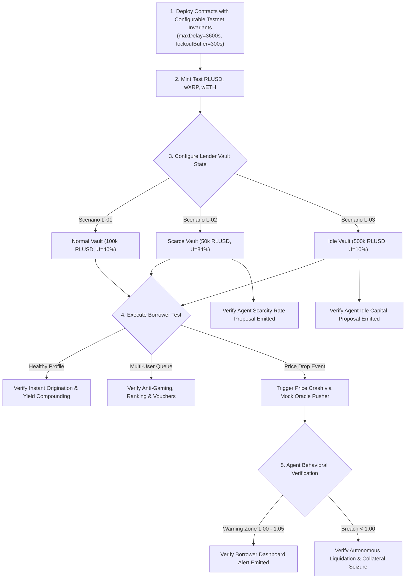

# Protocol Test Matrix & Validation Specification

This document defines the functional and behavioral test cases required for the **AI-Managed Lending Platform (AMLP)** across the **XRPL EVM Sidechain** and native **XRP Ledger**.

The test suite evaluates three interconnected layers:
1. **Smart Contract Invariants**: Mathematical solvency, non-custodial custody, and state transition safety.
2. **Vault Owner & Borrower Operational Profiles**: Liquidity abundance, liquidity scarcity, healthy loans, and distressed debt.
3. **AI Agent Bounded Reasoning**: Every structured agent proposal (rate adjustments, borrower prioritization, token onboarding) and autonomous liquidation executions.

---

## 1. Test Actor Personas & Test Harness Configuration

| Persona | Role / Balance Profile | Test Configuration |
| :--- | :--- | :--- |
| **Lender A (Standard)** | Vault Owner with active, normal-capacity vault. | Supplies 100,000 RLUSD, target utilization 80%. |
| **Lender B (Low Cash)** | Vault Owner with capital-constrained vault. | Supplies 50,000 RLUSD, 42,000 RLUSD borrowed ($U = 84\%$). |
| **Lender C (High Cash)** | Vault Owner with idle capital. | Supplies 500,000 RLUSD, 50,000 RLUSD borrowed ($U = 10\%$). |
| **Borrower 1 (Good Loan)** | High collateral, conservative borrowing. | Pledges \$20,000 wETH, borrows 7,000 RLUSD ($H_f = 2.28$). |
| **Borrower 2 (Bad Loan)** | Distressed borrower facing price drop. | Pledges \$10,000 wXRP, borrows 7,000 RLUSD ($H_f \text{ drops to } 0.95$). |
| **Borrower Cluster (Multi-User)** | 4 distinct borrowers competing for funds. | Each requests 15,000 RLUSD simultaneously. |
| **AI Lending Agent** | Off-chain coordinator (Gemini / AP4M). | Autonomous signer with EIP-712 signing key. |

---

## 2. Vault Owner (Lender) Test Cases

### Test Case L-01: Vault Accepting Normal Requests
* **Objective**: Verify standard vault origination when liquidity is within healthy operating bounds.
* **Initial State**:
  * Vault Liquidity: 100,000 RLUSD.
  * Active Debt: 40,000 RLUSD ($U = 40\%$).
  * Rate Model: Mode B (Base Rate $R_0 = 4\%$, $U_{\text{optimal}} = 80\%$, $R_1 = 4\%$, $R_2 = 40\%$).
* **Action**:
  * Borrower submits valid loan request for 10,000 RLUSD backed by 20,000 RLUSD of verified collateral (50% LTV).
* **Expected Smart Contract Outcome**:
  * Smart contract verifies $U < 75\%$ (Regime A: abundant liquidity).
  * 10,000 RLUSD disbursed instantaneously in the same transaction block without queueing.
  * Vault balance updates to 50,000 RLUSD cash, 50,000 RLUSD debt ($U = 50\%$).
* **Expected Agent Behavior**:
  * Agent logs origination telemetry; no rate or queue interventions required.

---

### Test Case L-02: Vault with Scarcity of Funds (Low Cash Buffer)
* **Objective**: Verify vault defense and queue activation when unborrowed liquidity is nearly exhausted.
* **Initial State**:
  * Vault Liquidity: 50,000 RLUSD total assets.
  * Active Debt: 42,000 RLUSD ($U = 84\%$).
  * Available Liquid Cash: 8,000 RLUSD.
* **Action**:
  * A single whale borrower requests 7,500 RLUSD (attempting to consume 93.7% of remaining cash).
* **Expected Smart Contract Outcome**:
  * Smart contract detects $U \ge 75\%$ (Regime B: Constrained Liquidity).
  * Direct instantaneous origination is blocked on-chain; applicant is routed to the AI Prioritization Queue.
* **Expected Agent Behavior**:
  * **Anti-Gaming Penalty**: Agent calculates exponential concentration penalty ($7,500 / 8,000 = 93.75\%$ consumption).
  * **Decision**: Rejects full drawdown or proposes bounded partial origination (e.g., max 2,500 RLUSD) to preserve the vault cash buffer.
  * **Owner Rate Proposal**: Submits **Scarcity & Yield Optimization Proposal** suggesting the owner steepen the Scarcity Jump Rate ($R_2$) or increase Base Rate ($R_0$).

---

### Test Case L-03: Vault with Surplus Idle Funds (High Cash Buffer)
* **Objective**: Verify agent detection of capital drag and proactive rate stimulation when cash sits idle.
* **Initial State**:
  * Vault Liquidity: 500,000 RLUSD total supplied.
  * Active Debt: 50,000 RLUSD ($U = 10\%$).
  * Available Liquid Cash: 450,000 RLUSD.
  * Duration: Utilization has remained under 20% for > 7 consecutive days.
* **Action**:
  * Agent telemetry monitor evaluates 7-day rolling performance against external market yields.
* **Expected Agent Behavior**:
  * Flags capital under-utilization.
  * Emits **Idle Capital Stimulation Proposal** to the owner dashboard:
    * *Observation*: 90% of vault funds are idle with low borrow demand.
    * *Agent Proposal*: Recommends lowering Fixed APR or Base Rate ($R_0$) by 1.0% to stimulate loan demand while staying above the owner's minimum hurdle rate.
* **Expected Smart Contract Outcome**:
  * The owner executes the proposed rate reduction with a single transaction; updated rate parameters take effect immediately for new borrows.

---

## 3. Borrower Test Cases

### Test Case B-01: Borrower with a Good Loan (Healthy Position)
* **Objective**: Validate normal loan lifecycle: drawing funds, accruing interest, withdrawing excess collateral, and repayment.
* **Initial State**:
  * Borrower deposits \$20,000 wETH into `CollateralVault`.
  * Collateral parameters: Max LTV = 70%, Liquidation Threshold = 80%.
* **Test Steps & Actions**:
  1. **Borrow**: Borrower draws 7,000 RLUSD (35% LTV, Health Factor $H_f = 2.28$).
  2. **Yield Accrual**: Simulate 10,000 blocks of interest accrual. Debt grows to 7,050 RLUSD.
  3. **Collateral Withdrawal**: Borrower withdraws \$5,000 of excess wETH.
     * Remaining collateral: \$15,000.
     * Projected Health Factor: $(\$15,000 \times 0.80) / 7,050 = 1.70$.
  4. **Repayment**: Borrower repays 7,050 RLUSD.
* **Expected Smart Contract Outcome**:
  * Step 1: 7,000 RLUSD transferred to borrower; `amRLUSD` vault share exchange rate stable.
  * Step 3: Withdrawal succeeds because projected $H_f \ge 1.05$.
  * Step 4: Debt extinguished; 90% of net interest compounds into vault shares, 10% routed to `ProtocolReserveVault`. All collateral unlocked.
* **Expected Agent Behavior**:
  * Logs healthy position status throughout; zero risk alerts dispatched.

---

### Test Case B-02: Borrower with a Bad Loan (Distressed Position & Liquidation Trigger)
* **Objective**: Verify transition from healthy $\rightarrow$ warning zone $\rightarrow$ liquidatable state following collateral price drops.
* **Initial State**:
  * Borrower pledges 10,000 XRP via native XRPL escrow (XRP price = \$1.00, collateral value = \$10,000).
  * Liquidation Threshold = 80%.
  * Borrower draws 7,000 RLUSD debt (Initial Health Factor $H_f = (\$10,000 \times 0.80) / 7,000 = 1.14$).
* **Test Steps & Actions**:
  1. **Step 1 (Moderate Price Drop)**: Oracle price of XRP drops to \$0.90 (Collateral = \$9,000).
     * New Health Factor: $(\$9,000 \times 0.80) / 7,000 = 1.028$ (Warning Zone: $1.00 \le H_f < 1.05$).
  2. **Step 2 (Severe Price Drop)**: Oracle price drops to \$0.80 (Collateral = \$8,000).
     * New Health Factor: $(\$8,000 \times 0.80) / 7,000 = 0.914$ (Undercollateralized: $H_f < 1.00$).
  3. **Step 3 (Liquidation Execution)**: Liquidator repays 50% of debt (3,500 RLUSD).
* **Expected Smart Contract Outcome**:
  * Step 1: Contract blocks new borrowing and rejects collateral withdrawal attempts.
  * Step 2: Contract permits liquidation state transitions.
  * Step 3: Liquidator pays 3,500 RLUSD; receives \$3,675 worth of seized XRP (5% liquidation bonus).
* **Expected Agent Behavior**:
  * Step 1: Dispatches high-priority "At Risk" warning alert to borrower dashboard.
  * Step 2: Agent pre-simulates DEX slippage, detects sub-1.00 breach, and prepares liquidation transaction intent.

---

### Test Case B-03: Multi-User Requests under Abundant Funds
* **Objective**: Verify concurrent borrower requests are all fulfilled without friction when vault cash is plentiful.
* **Initial State**:
  * Vault Liquidity: 200,000 RLUSD cash available ($U = 20\%$).
* **Action**:
  * 4 distinct borrowers (Borrowers A, B, C, D) simultaneously apply for 15,000 RLUSD each (Total requested: 60,000 RLUSD).
  * All 4 provide verified collateral satisfying the 70% LTV floor.
* **Expected Smart Contract Outcome**:
  * Post-origination utilization: $100,000 / 200,000 = 50\% < 75\%$.
  * All 4 loans originate on-demand in parallel; zero borrowers sent to queue.
* **Expected Agent Behavior**:
  * Normal telemetry stream; logs 4 concurrent originations.

---

### Test Case B-04: Multi-User Requests under Constrained Funds (Competition & Queue)
* **Objective**: Verify fair capital rationing, anti-gaming checks, and queue prioritization when total borrow demand exceeds unreserved cash.
* **Initial State**:
  * Vault Cash Buffer: 30,000 RLUSD available ($U = 80\%$).
* **Action**:
  * 4 distinct borrowers apply simultaneously for 15,000 RLUSD each (Total demand: 60,000 RLUSD vs. 30,000 RLUSD available):
    * **Applicant 1**: 40% LTV, native XRPL escrow collateral, 5 past successful loan repayments.
    * **Applicant 2**: 68% LTV, EVM ERC-20 collateral, fresh wallet address.
    * **Applicant 3**: 45% LTV, fresh fiat on-ramp deposit (within bank dispute window).
    * **Applicant 4 (Whale)**: 50% LTV, requests 28,000 RLUSD (93% of entire available cash).
* **Expected Smart Contract Outcome**:
  * Direct execution reverts; all requests routed to AI Prioritization Queue.
* **Expected Agent Behavior**:
  * **Applicant 4 (Whale)**: Heavily penalized under Concentration Penalty check (>25% consumption).
  * **Applicant 3**: Deprioritized under Provenance Defense mode (unseasoned fiat deposit).
  * **Applicant 1**: Top-ranked (deep collateral cushion, proven track record, irrevocable native XRPL collateral).
  * **Applicant 2**: Second-ranked with adjusted terms (offered 10,000 RLUSD instead of 15,000 to fit cash buffer).
  * Agent issues cryptographically signed `LoanAllocationVouchers` for Applicants 1 and 2, exhausting the 30,000 RLUSD fairly without draining reserves.

---

## 4. AI Agent Proposal & Liquidation Test Matrix

This matrix maps each agent capability directly to its triggering scenario and verification criteria:

| Agent Component | Triggering Scenario | Expected Proposal / Action | Verification Criteria |
| :--- | :--- | :--- | :--- |
| **Proposal 1: Idle Capital Stimulation** | Case L-03 (Surplus idle cash, $U < 20\%$) | Proposes lowering Base Rate ($R_0$) or Fixed APR. | Proposal appears on owner dashboard; bounded above owner hurdle rate. |
| **Proposal 2: Scarcity & Yield Optimization** | Case L-02 (High utilization, $U > 85\%$) | Proposes steepening Scarcity Jump Rate ($R_2$) or raising $R_0$. | Proposal calculates projected impact on cash replenishment. |
| **Proposal 3: Market Alignment** | Macro benchmark yield rises by >100 bps for >72h | Proposes aligning vault APR to prevent borrow arbitrage. | Cross-references Pyth/Band external benchmarks against vault APR. |
| **Proposal 4: Capital Distribution Policy** | Case B-04 (Scarce cash + competing borrowers) | Proposes diversified allocation batch over whale loan. | Whale penalized; smaller diversified loans receive allocation vouchers. |
| **Proposal 5: Volatility Buffer Policy** | Market price volatility spikes >30% in 24h | Proposes temporarily capping accepted LTV at 45% (vs 70%). | Protects vault capital against sudden collateral flash crashes. |
| **Proposal 6: Provenance Defense Policy** | Influx of fresh fiat gateway deposits | Proposes prioritizing native XRPL escrows over unseasoned card deposits. | Zero-chargeback collateral prioritized until ACH/card clearance seasons. |
| **Proposal 7: Balanced Growth Policy** | Stable market conditions & steady repayment | Proposes standard origination terms with repeat borrower rewards. | Maximizes capital efficiency and owner yield generation. |
| **Proposal 8: Token Onboarding Proposal** | Candidate ERC-20 token submitted | Evaluates bytecode, liquidity depth, and dual oracles; proposes bounded terms. | Owner manually reviews audit report and signs onboarding transaction. |
| **Execution: Autonomous Liquidation** | Case B-02 (Health Factor drops to 0.95) | Submits liquidation intent with optimal gas to repay 50% of debt. | Smart contract settles debt, pays 5% bonus to liquidator, and recovers capital. |
| **Execution: Deep Default Liquidation** | Health Factor drops below 0.90 | Submits 100% close factor liquidation to clear entire loan. | Full debt extinguished; shortfall (if any) drawn from `ProtocolReserveVault`. |

---

## 5. End-to-End Test Execution Workflow



---

## 6. Implementation Test Commands

The automated tests are mapped to the following command structure:

```bash
# 1. Run Core Smart Contract Unit Tests (LendingVault, CollateralVault, RiskEngine)
npm run test:contracts

# 2. Run Lender & Borrower Scenario Tests (Healthy, Idle, Scarcity, Multi-User)
npm run test:scenarios

# 3. Run AI Agent Bounded Reasoning & Proposal Tests
npm run test:agent-proposals

# 4. Run Liquidation & Oracle Fallback Stress Tests
npm run test:liquidations

# 5. Run Full End-to-End Testnet Integration Suite
npm run test:e2e
```
